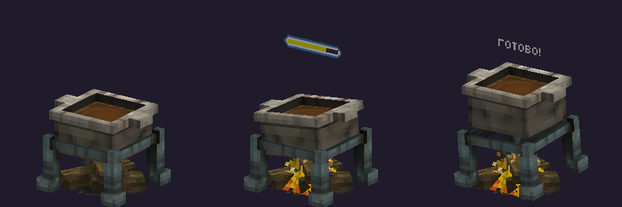
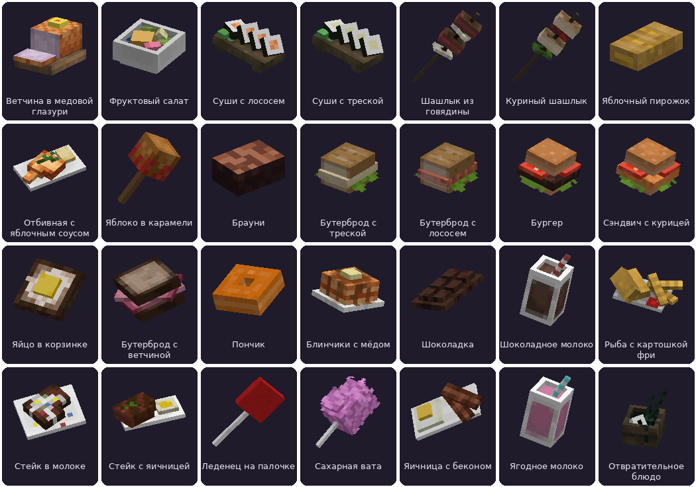

# Готовка

В **походном котелке** можно сварить 83 блюда — борщ, пельмени, блины, плов, голубцы, паста, карри, пироги, бургеры, суши, шашлыки, сладости и напитки.
Каждое блюдо готовится из **двух ингредиентов** за несколько секунд. Блюда сытнее обычной еды,
а некоторые ещё и дают короткий полезный эффект.

## Походный котелок

**Рецепт** (верстак, в любом порядке): **котёл + костёр**. Котелок есть в книге рецептов.

1. **Поставьте** котелок на твёрдый блок, как обычный блок. Вплотную к другому котелку нельзя (через блок можно),
   в одном чанке — до 8 котелков. В чужом привате, где вам нельзя строить, котелок не встанет.
2. **Разожгите** огонь: ПКМ по котелку **огнивом** или огненным зарядом. Огонь горит, пока котелок стоит.
3. **Уберите** котелок ударом — это может только тот, кто его поставил. Пока котелок варит, убрать нельзя.

!!! info "Это не котёл для BreweryX"
    Котелок — отдельный предмет со своей моделью. Он не превращается в блок котла, и [варка напитков BreweryX](survival.md#алкоголь)
    в нём не работает. Готовке и BreweryX не мешают друг другу.

## Как готовить

1. Возьмите ингредиент в **основную руку** и нажмите **ПКМ** по горящему котелку — он булькнет и покажет, что внутри.
2. Бросьте **второй** ингредиент (между бросками около секунды).
3. **Нарезка** — мини-игра, см. ниже. Играет тот, кто бросил второй ингредиент.
4. Над котелком появится шкала. Во время варки котелок дважды закипит — **помешайте**.
5. Котелок подпрыгнет, покажет **«ГОТОВО!»** и ваши **звёзды** — блюдо окажется у вас в инвентаре.

- **Порядок** ингредиентов не важен.
- Два одинаковых ингредиента или сочетание, которого нет в рецептах, — получится **Отвратительное блюдо**.
- От мёда остаётся бутылка, от молока — ведро, они возвращаются сразу.
- Если повар отошёл дальше 48 блоков или вышел из игры, блюдо упадёт у котелка. Полный инвентарь — упадёт под ноги.
- В котелок кладутся только обычные ванильные предметы: особые вещи с эффектами плагинов он не примет.
- Если убрать котелок с одним ингредиентом внутри, ингредиент выпадет вместе с котелком (кроме мёда и молока —
  тару вы уже получили).

Рецепты есть и в игре: **`/cook`** (или `/готовка`) открывает книгу рецептов — там же ваше звание и рекорд
по каждому блюду.

## Мини-игры

**Нарезка.** Над котелком появляется полоска с ножом, нож бегает туда-сюда. Нажмите **ПКМ по котелку** (или
ударьте его), когда нож над **зелёной** частью. Ровно в **золотую** клетку — «Идеально!». Подходов три,
у каждого своя зелёная зона. Пинг учитывается: нажимайте, когда видите нож над зеленью.

**Помешай!** Во время варки котелок дважды закипает: пузыри, всплески и надпись «Помешай!». Успейте нажать
ПКМ по котелку за секунду с небольшим — иначе подгорит.

Готовит один повар — тот, кто бросил второй ингредиент. Отойдёте дальше 8 блоков — подход не засчитается.
Неверное сочетание сразу варится в «Отвратительное блюдо», без мини-игр.

## Звёзды качества

| Звёзды | Оценка | Сытость и насыщение | Эффекты |
|---|---|---|---|
| ★☆☆☆☆ | Так себе | ×0,7 | вдвое короче |
| ★★☆☆☆ | Неплохо | ×0,85 | на четверть короче |
| ★★★☆☆ | Хорошо | как в таблице | как в таблице |
| ★★★★☆ | Отлично | ×1,15 | на четверть дольше |
| ★★★★★ | **Шедевр!** | ×1,3 | в полтора раза дольше, золотое имя и свечение |

Звёзды видны в описании блюда, там же имя повара. Нарезка даёт до 2 очков за подход (идеально — 2, зелёное — 1),
помешивание — по очку. Почти всё идеально — шедевр.

## Звания поваров

Каждая звезда идёт в копилку повара. По сумме звёзд — звание:

| Звание | Звёзд |
|---|---|
| Поварёнок | 0 |
| Кухарь | 30 |
| Повар | 100 |
| Шеф-повар | 300 |
| Мастер-шеф | 800 |
| Легенда кухни | 2000 |

- `/cook top` — десять лучших поваров сервера.
- `/cook stats [ник]` — звание, звёзды, сколько рецептов открыто и сколько шедевров.

## Рецепты

Сытость — в окорочках на шкале голода. Для сравнения: стейк — 4 окорочка и 12,8 насыщения, хлеб — 2,5 и 6.

<input class="nw-filter" type="search" placeholder="Найти: хлеб, молоко, скорость…" autocomplete="off">

Ничего не нашлось.

| Блюдо | Из чего | Сытость | Насыщение | Что ещё даёт |
|---|---|---|---|---|
| Ветчина в медовой глазури | бутылочка мёда + сырая свинина | 4,5 | 12,6 | Регенерация I, 5 с |
| Фруктовый салат | два **разных** фрукта: ломтик арбуза, яблоко, сладкие ягоды | 3 | 7,2 | Скорость I, 30 с |
| Суши с лососем | сырой лосось + сушёная ламинария | 3,5 | 9,8 | Подводное дыхание, 1:30 |
| Суши с треской | сырая треска + сушёная ламинария | 3 | 8,4 | Подводное дыхание, 1:00 |
| Шашлык из говядины | сырая говядина + палка | 5 | 14 | — |
| Куриный шашлык | сырая курица + палка | 4 | 11,2 | — |
| Яблочный пирожок | яблоко + хлеб | 3,5 | 8,4 | — |
| Отбивная с яблочным соусом | сырая свинина + яблоко | 5 | 13 | — |
| Яблоко в карамели | сахар + яблоко | 2,5 | 6 | Скорость I, 20 с |
| Брауни | какао-бобы + хлеб | 3 | 6 | Спешка I, 45 с |
| Бутерброд с треской | сырая треска + хлеб | 4 | 10 | — |
| Бутерброд с лососем | сырой лосось + хлеб | 4,5 | 11 | — |
| Бургер | сырая говядина + хлеб | 5,5 | 15 | — |
| Сэндвич с курицей | сырая курица + хлеб | 4,5 | 11 | — |
| Яйцо в корзинке | яйцо + хлеб | 3,5 | 9 | — |
| Бутерброд с ветчиной | сырая свинина + хлеб | 4,5 | 11 | — |
| Пончик | хлеб + сахар | 2,5 | 4 | Скорость I, 15 с |
| Блинчики с мёдом | бутылочка мёда + хлеб | 3,5 | 9 | — |
| Шоколадка | какао-бобы + сахар | 2 | 4 | Спешка I, 1:00; съедается вдвое быстрее |
| Шоколадное молоко | какао-бобы + ведро молока | 2 | 4 | Снимает все эффекты, как молоко |
| Рыба с картошкой фри | сырая треска + картофель | 5 | 12 | — |
| Стейк в молоке | ведро молока + сырая говядина | 5 | 12 | — |
| Стейк с яичницей | сырая говядина + яйцо | 5,5 | 14 | — |
| Леденец на палочке | сахар + палка | 1,5 | 2 | Скорость I, 20 с; можно есть сытым, съедается быстро |
| Сахарная вата | сахар + нить | 1,5 | 1 | Прыгучесть I, 20 с; можно есть сытым, съедается быстро |
| Яичница с беконом | сырая свинина + яйцо | 5 | 13 | — |
| Ягодное молоко | сладкие ягоды + ведро молока | 2,5 | 6 | Снимает все эффекты, как молоко |
| Борщ | свёкла + сырая говядина | 5 | 14 | Регенерация I, 6 с |
| Пельмени | пшеница + сырая говядина | 5 | 13 | — |
| Блины со сметаной | пшеница + ведро молока | 4 | 10 | Спешка I, 30 с |
| Вареники с картошкой | пшеница + картофель | 4,5 | 11 | — |
| Шашлык из баранины | сырая баранина + палка | 5 | 14 | — |
| Тушёный кролик | сырая крольчатина + морковь | 5 | 14 | Прыгучесть I, 30 с |
| Картошка с грибами | гриб + картофель | 4,5 | 11 | — |
| Грибной суп | гриб + ведро молока | 4 | 11 | Ночное зрение, 1:00 |
| Тыквенная каша | тыква + ведро молока | 4 | 10 | Регенерация I, 4 с |
| Морковный торт | морковь + сахар | 3 | 7 | Ночное зрение, 45 с |
| Оливье | картофель + яйцо | 4,5 | 11 | — |
| Уха | сырая треска + морковь | 4 | 11 | Подводное дыхание, 1:00 |
| Плов | сырая баранина + морковь | 5,5 | 15 | — |
| Курица с картошкой | сырая курица + картофель | 5 | 13 | — |
| Омлет | яйцо + ведро молока | 3,5 | 9 | — |
| Печёное яблоко | яблоко + бутылочка мёда | 2,5 | 7 | Регенерация I, 3 с |
| Ягодное варенье | сладкие ягоды + сахар | 2 | 4 | Скорость I, 15 с; можно есть сытым |
| Медовый пряник | пшеница + бутылочка мёда | 2,5 | 6 | Спешка I, 30 с |
| Пломбир | ведро молока + сахар | 2 | 3 | Огнестойкость, 30 с; можно есть сытым |
| Светящееся желе | светящиеся ягоды + сахар | 1,5 | 2 | Ночное зрение, 30 с; можно есть сытым, съедается быстро |
| Квас | пшеница + сахар | 1,5 | 3 | Скорость I, 30 с; пьётся, можно пить сытым |
| Винегрет | свёкла + картофель | 4 | 10 | — |
| Шоколадный кекс | какао-бобы + яйцо | 2,5 | 6 | Спешка I, 45 с |
| Рождественские пирожки | пшеница + яблоко | 3 | 7 | — |
| Рождественский пудинг | сахар + яйцо | 3,5 | 9 | Регенерация I, 5 с |
| Пряничный домик | бутылочка мёда + сахар | 3 | 6 | Спешка I, 1:00 |
| Шоколадное полено | какао-бобы + пшеница | 3 | 7 | Спешка I, 30 с |
| Суп с лапшой | пшеница + сырая курица | 4,5 | 12 | Регенерация I, 4 с |
| Крем со светящимися ягодами | светящиеся ягоды + ведро молока | 2,5 | 6 | Ночное зрение, 1:00; можно есть сытым |
| Стейк с картофелем | сырая говядина + картофель | 5,5 | 15 | — |
| Запечённая курица | сырая курица + морковь | 6 | 16 | — (целая курица, ест дольше) |
| Рататуй | свёкла + тыква | 4 | 10 | — |
| Овощной салат | морковь + картофель | 3 | 8 | Скорость I, 20 с |
| Паста с фрикадельками | пшеница + сырая свинина | 5 | 13 | — |
| Голубцы | сырая говядина + сушёная ламинария | 5 | 13 | — |
| Фаршированная картошка | сырая свинина + картофель | 4,5 | 11 | — |
| Грибная каша | гриб + пшеница | 4 | 10 | Ночное зрение, 30 с |
| Чёрная паста | пшеница + чернильный мешок | 4 | 10 | Подводное дыхание, 45 с |
| Лапша с овощами | пшеница + морковь | 4 | 10 | — |
| Бараньи рёбрышки | сырая баранина + бутылочка мёда | 5,5 | 14 | — |
| Шаурма с бараниной | сырая баранина + хлеб | 5 | 12 | — |
| Карри с курицей | сырая курица + тыква | 4,5 | 12 | Огнестойкость, 30 с |
| Лосось с овощами | сырой лосось + морковь | 4,5 | 12 | Подводное дыхание, 45 с |
| Рыба в пергаменте | сырая треска + гриб | 4,5 | 12 | — |
| Киш лорен | пшеница + яйцо | 4,5 | 11 | — |
| Пирог «Звездочёт» | сырой лосось + пшеница | 4,5 | 11 | Подводное дыхание, 1:00 |
| Спринг-роллы | морковь + сушёная ламинария | 3,5 | 9 | — |
| Шпажки в бульоне | сырая курица + гриб | 4,5 | 11 | Регенерация I, 4 с |
| Маклюба | сырая баранина + тыква | 5,5 | 14 | — |
| Бурек | пшеница + сырая баранина | 4,5 | 11 | — |
| Кнафе | бутылочка мёда + ведро молока | 3 | 7 | Спешка I, 30 с |
| Хало-хало | светящиеся ягоды + ломтик арбуза | 2,5 | 5 | Скорость I, 30 с; можно есть сытым |
| Энсаймада | хлеб + ведро молока | 3 | 7 | — |
| Тыквенный пирог | тыква + сахар | 5 | 12 | — (целый пирог, ест дольше) |
| Тарелка печенья | какао-бобы + бутылочка мёда | 3 | 5 | Спешка I, 30 с; можно есть сытым |
| Треска на углях | сырая треска + палка | 3,5 | 10 | — |
| Отвратительное блюдо | любое другое сочетание | 1 | 0 | Тошнота 10 с и Голод 15 с |

Яйцо подходит любое: белое, синее или коричневое. Гриб — красный или коричневый, чернильный мешок — обычный или светящийся.

## Что даёт еда

- **Сытость и насыщение.** Блюда кормят лучше, чем их ингредиенты по отдельности: бургер сытнее стейка,
  а сладости наоборот лёгкие, зато их можно перекусить на бегу.
- **Эффекты** короткие и мирные: скорость, спешка (быстрее копать), подводное дыхание, регенерация, прыгучесть,
  ночное зрение, огнестойкость.
  Боевых усилений у блюд нет.
- **Квас** просто бодрит — это не молоко, эффекты он не снимает.
- **Шоколадное и ягодное молоко** пьются как молоко: снимают все эффекты, хорошие и плохие, и при
  [болезнях](survival.md#болезни) помогают так же, как обычное молоко. После них остаётся ведро. Напитки складываются по 16.
- **Отвратительное блюдо** лучше не есть: от него мутит и сильнее хочется есть.

## Авторы

Модели, текстуры и звуки котелка и первых 27 блюд — **Little Room** ([patreon.com/littleroomdev](https://www.patreon.com/littleroomdev)).
Мы перенесли их на свой плагин, перевели на русский и перерисовали надпись на шкале.
23 блюда — от борща до шоколадного кекса — нарисованы для NightWorld в том же стиле.

Ещё 33 блюда — модели из открытых модов и паков, спасибо авторам! Мы перенесли модели в ресурс-пак сервера
и поменяли пути файлов; тексты лицензий — в ресурс-паке, в папке `assets/nightcook/credits/`.

| Откуда | Автор | Лицензия | Блюда |
|---|---|---|---|
| [Clowd's Christmas Food & Hats](https://modrinth.com/resourcepack/clowds-christmas-food-hat-pack) | Clowd | MIT | Рождественские пирожки, Рождественский пудинг, Пряничный домик, Шоколадное полено |
| [Farmer's 3D](https://modrinth.com/resourcepack/farmers-3d) (по мотивам [Farmer's Delight](https://modrinth.com/mod/farmers-delight), vectorwing, MIT) | Pder | MIT | Суп с лапшой, Крем со светящимися ягодами, Стейк с картофелем, Запечённая курица |
| [Display Delight](https://modrinth.com/mod/display-delight) (+ текстура миски из [порта cargocats](https://github.com/cargocats/DisplayDelight)) | jkvin114 | LGPL-3.0 | Рататуй, Овощной салат, Паста с фрикадельками, Голубцы, Фаршированная картошка, Грибная каша, Чёрная паста, Лапша с овощами, Бараньи рёбрышки, Шаурма с бараниной, Карри с курицей, Лосось с овощами |
| [Casualness Delight](https://modrinth.com/mod/casualness-delight) | TsukimiRen | MIT | Рыба в пергаменте, Киш лорен, Пирог «Звездочёт», Спринг-роллы, Шпажки в бульоне |
| [Ramadan Delight](https://modrinth.com/mod/ramadan-delight) | Eggmain, MehdiNoui | MIT | Маклюба, Бурек, Кнафе |
| [Ube's Delight](https://modrinth.com/mod/ubes-delight) | ChefMooon | MIT | Хало-хало, Энсаймада |
| [TW's Decorative Food](https://modrinth.com/mod/decorative-food) | 666daji | MIT | Тыквенный пирог, Тарелка печенья, Треска на углях |
