# Все вещи гардероба

В гардеробе **482 вещей**. Ниже — все наборы, внешний вид, подходящие предметы и редкость.

Как надеть и получить вещи — на странице [«Гардероб»](wardrobe.md).

Для вещей с выбором цвета показан исходный цвет. Доспехи комплекта представлены нагрудником;
скин применяется ко всей надетой броне.

<input id="wardrobe-filter" class="nw-filter" type="search" aria-label="Поиск по вещам гардероба" placeholder="Поиск: название, набор, меч, легендарная…" autocomplete="off">

Ничего не нашлось.

## Лето

| Вид | Название | Куда надевается | Редкость |
|---|---|---|---|
| 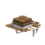{ .nw-item-icon width="32" height="32" loading="lazy" decoding="async" } | Панама рыбака Лето | Шапка — на шлем | Редкая |
| 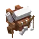{ .nw-item-icon width="32" height="32" loading="lazy" decoding="async" } | Рюкзак рыбака Лето | На спину / на нагрудник | Эпическая |
| 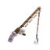{ .nw-item-icon width="32" height="32" loading="lazy" decoding="async" } | Удочка рыбака Лето | Для рук: удочка | Обычная |
| 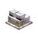{ .nw-item-icon width="32" height="32" loading="lazy" decoding="async" } | Шапка-лягушка Лето | Шапка — на шлем | Редкая |
| 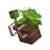{ .nw-item-icon width="32" height="32" loading="lazy" decoding="async" } | Рюкзак-лотос Лето | На спину / на нагрудник | Эпическая |
| 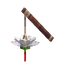{ .nw-item-icon width="32" height="32" loading="lazy" decoding="async" } | Фонарик-лотос Лето | Для рук: фонарь | Обычная |
| 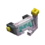{ .nw-item-icon width="32" height="32" loading="lazy" decoding="async" } | Маска для дайвинга Лето | Шапка — на шлем | Редкая |
| 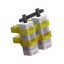{ .nw-item-icon width="32" height="32" loading="lazy" decoding="async" } | Акваланг Лето | На спину / на нагрудник | Эпическая |
| 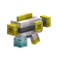{ .nw-item-icon width="32" height="32" loading="lazy" decoding="async" } | Пузырьковый бластер Лето | Для рук: лук, арбалет | Обычная |
| 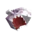{ .nw-item-icon width="32" height="32" loading="lazy" decoding="async" } | Шапка-акула Лето | Шапка — на шлем | Редкая |
| 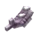{ .nw-item-icon width="32" height="32" loading="lazy" decoding="async" } | Хвост акулы Лето | На спину / на нагрудник | Эпическая |
| 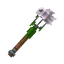{ .nw-item-icon width="32" height="32" loading="lazy" decoding="async" } | Острога Лето | Для рук: трезубец | Обычная |

## Путешественник

| Вид | Название | Куда надевается | Редкость |
|---|---|---|---|
| 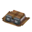{ .nw-item-icon width="32" height="32" loading="lazy" decoding="async" } | Шляпа путешественника Путешественник | Шапка — на шлем | Редкая |
| 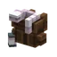{ .nw-item-icon width="32" height="32" loading="lazy" decoding="async" } | Рюкзак путешественника Путешественник | На спину / на нагрудник | Эпическая |
| 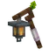{ .nw-item-icon width="32" height="32" loading="lazy" decoding="async" } | Фонарь путешественника Путешественник | Для рук: фонарь | Обычная |

## Аксолотль

| Вид | Название | Куда надевается | Редкость |
|---|---|---|---|
| 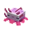{ .nw-item-icon width="32" height="32" loading="lazy" decoding="async" } | Шапка-аксолотль Аксолотль | Шапка — на шлем | Редкая |
| 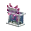{ .nw-item-icon width="32" height="32" loading="lazy" decoding="async" } | Аквариум с аксолотлем Аксолотль | На спину / на нагрудник | Эпическая |
| 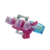{ .nw-item-icon width="32" height="32" loading="lazy" decoding="async" } | Водный пистолет Аксолотль | Для рук: лук, арбалет | Обычная |

## Японские легенды

| Вид | Название | Куда надевается | Редкость |
|---|---|---|---|
| 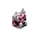{ .nw-item-icon width="32" height="32" loading="lazy" decoding="async" } | Маска кицунэ Японские легенды | Шапка — на шлем | Редкая |
| 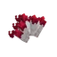{ .nw-item-icon width="32" height="32" loading="lazy" decoding="async" } | Хвосты кицунэ Японские легенды | На спину / на нагрудник | Легендарная |
| 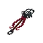{ .nw-item-icon width="32" height="32" loading="lazy" decoding="async" } | Посох кицунэ Японские легенды | Для рук: меч, трезубец | Эпическая |
| 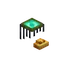{ .nw-item-icon width="32" height="32" loading="lazy" decoding="async" } | Шляпа каппы Японские легенды | Шапка — на шлем | Редкая |
| 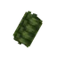{ .nw-item-icon width="32" height="32" loading="lazy" decoding="async" } | Панцирь каппы Японские легенды | На спину / на нагрудник | Эпическая |
| 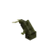{ .nw-item-icon width="32" height="32" loading="lazy" decoding="async" } | Обед каппы Японские легенды | Для рук: тотем | Обычная |
| 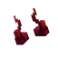{ .nw-item-icon width="32" height="32" loading="lazy" decoding="async" } | Рога они Японские легенды | Шапка — на шлем | Редкая |
| 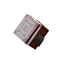{ .nw-item-icon width="32" height="32" loading="lazy" decoding="async" } | Барабан они Японские легенды | На спину / на нагрудник | Эпическая |
| 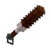{ .nw-item-icon width="32" height="32" loading="lazy" decoding="async" } | Дубина они Японские легенды | Для рук: меч, топор, булава | Обычная |
| 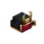{ .nw-item-icon width="32" height="32" loading="lazy" decoding="async" } | Шлем самурая Японские легенды | Шапка — на шлем | Редкая |
| 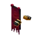{ .nw-item-icon width="32" height="32" loading="lazy" decoding="async" } | Знамя самурая Японские легенды | На спину / на нагрудник | Легендарная |
| 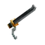{ .nw-item-icon width="32" height="32" loading="lazy" decoding="async" } | Катана Японские легенды | Для рук: меч | Эпическая |

## Король

| Вид | Название | Куда надевается | Редкость |
|---|---|---|---|
| 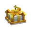{ .nw-item-icon width="32" height="32" loading="lazy" decoding="async" } | Корона короля Король | Шапка — на шлем | Легендарная |
| 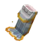{ .nw-item-icon width="32" height="32" loading="lazy" decoding="async" } | Королевская мантия Король | На спину / на нагрудник | Легендарная |
| 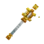{ .nw-item-icon width="32" height="32" loading="lazy" decoding="async" } | Королевский скипетр Король | Для рук: меч, булава | Эпическая |

## Пастельная весна

| Вид | Название | Куда надевается | Редкость |
|---|---|---|---|
| 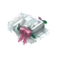{ .nw-item-icon width="32" height="32" loading="lazy" decoding="async" } | Весенняя шляпка Пастельная весна | Шапка — на шлем | Редкая |
| 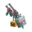{ .nw-item-icon width="32" height="32" loading="lazy" decoding="async" } | Весенняя сумочка Пастельная весна | На спину / на нагрудник | Эпическая |
| 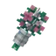{ .nw-item-icon width="32" height="32" loading="lazy" decoding="async" } | Весенний букет Пастельная весна | Для рук: тотем | Обычная |

## Полярник

| Вид | Название | Куда надевается | Редкость |
|---|---|---|---|
| 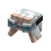{ .nw-item-icon width="32" height="32" loading="lazy" decoding="async" } | Шапка полярника Полярник | Шапка — на шлем | Редкая |
| 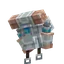{ .nw-item-icon width="32" height="32" loading="lazy" decoding="async" } | Рюкзак полярника Полярник | На спину / на нагрудник | Эпическая |
| 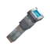{ .nw-item-icon width="32" height="32" loading="lazy" decoding="async" } | Подзорная труба полярника Полярник | Для рук: подзорная труба | Обычная |
| 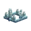{ .nw-item-icon width="32" height="32" loading="lazy" decoding="async" } | Ледяная корона Полярник | Шапка — на шлем | Редкая |
| 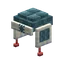{ .nw-item-icon width="32" height="32" loading="lazy" decoding="async" } | Шапка-ушанка Полярник | Шапка — на шлем | Редкая |
| 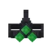{ .nw-item-icon width="32" height="32" loading="lazy" decoding="async" } | Очки ночного видения Полярник | Шапка — на шлем | Редкая |
| 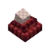{ .nw-item-icon width="32" height="32" loading="lazy" decoding="async" } | Шапка с помпоном Полярник | Шапка — на шлем | Редкая |
| 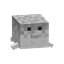{ .nw-item-icon width="32" height="32" loading="lazy" decoding="async" } | Тюленёнок Полярник | Шапка — на шлем | Редкая |
| 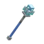{ .nw-item-icon width="32" height="32" loading="lazy" decoding="async" } | Ледяной посох Полярник | Для рук: меч, трезубец, булава | Обычная |
| 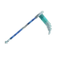{ .nw-item-icon width="32" height="32" loading="lazy" decoding="async" } | Ледяная коса Полярник | Для рук: мотыга, меч | Обычная |
| 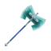{ .nw-item-icon width="32" height="32" loading="lazy" decoding="async" } | Ледяная секира Полярник | Для рук: топор, меч | Обычная |
| 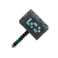{ .nw-item-icon width="32" height="32" loading="lazy" decoding="async" } | Молот вьюги Полярник | Для рук: булава, топор | Обычная |
| 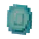{ .nw-item-icon width="32" height="32" loading="lazy" decoding="async" } | Ледяной щит Полярник | Для рук: щит | Обычная |

## Солнце и Луна

| Вид | Название | Куда надевается | Редкость |
|---|---|---|---|
| 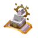{ .nw-item-icon width="32" height="32" loading="lazy" decoding="async" } | Шляпа солнечного мага Солнце и Луна | Шапка — на шлем | Редкая |
| { .nw-item-icon width="32" height="32" loading="lazy" decoding="async" } | Плащ солнечного мага Солнце и Луна | На спину / на нагрудник | Легендарная |
| { .nw-item-icon width="32" height="32" loading="lazy" decoding="async" } | Посох солнечного мага Солнце и Луна | Для рук: меч, трезубец, булава | Эпическая |
| { .nw-item-icon width="32" height="32" loading="lazy" decoding="async" } | Шляпа лунного мага Солнце и Луна | Шапка — на шлем | Редкая |
| { .nw-item-icon width="32" height="32" loading="lazy" decoding="async" } | Плащ лунного мага Солнце и Луна | На спину / на нагрудник | Легендарная |
| { .nw-item-icon width="32" height="32" loading="lazy" decoding="async" } | Посох лунного мага Солнце и Луна | Для рук: меч, трезубец, булава | Эпическая |

## Сунь Укун

| Вид | Название | Куда надевается | Редкость |
|---|---|---|---|
| { .nw-item-icon width="32" height="32" loading="lazy" decoding="async" } | Венец Сунь Укуна Сунь Укун | Шапка — на шлем | Эпическая |
| { .nw-item-icon width="32" height="32" loading="lazy" decoding="async" } | Доспех Сунь Укуна Сунь Укун | На спину / на нагрудник | Легендарная |
| { .nw-item-icon width="32" height="32" loading="lazy" decoding="async" } | Посох Сунь Укуна Сунь Укун | Для рук: меч, трезубец, булава | Легендарная |

## Рождество

| Вид | Название | Куда надевается | Редкость |
|---|---|---|---|
| { .nw-item-icon width="32" height="32" loading="lazy" decoding="async" } | Снежная шапка Рождество | Шапка — на шлем | Редкая |
| { .nw-item-icon width="32" height="32" loading="lazy" decoding="async" } | Новогодний колпак Рождество | Шапка — на шлем | Редкая |
| { .nw-item-icon width="32" height="32" loading="lazy" decoding="async" } | Оленьи рожки Рождество | Шапка — на шлем | Редкая |
| { .nw-item-icon width="32" height="32" loading="lazy" decoding="async" } | Шапка Санты Рождество | Шапка — на шлем | Редкая |
| { .nw-item-icon width="32" height="32" loading="lazy" decoding="async" } | Маска снеговика Рождество | Шапка — на шлем | Редкая |
| { .nw-item-icon width="32" height="32" loading="lazy" decoding="async" } | Колпак эльфа Рождество | Шапка — на шлем | Редкая |
| { .nw-item-icon width="32" height="32" loading="lazy" decoding="async" } | Ёлочка Рождество | Шапка — на шлем | Редкая |
| { .nw-item-icon width="32" height="32" loading="lazy" decoding="async" } | Карнавальная маска Рождество | Шапка — на шлем | Редкая |
| { .nw-item-icon width="32" height="32" loading="lazy" decoding="async" } | Праздничный колпак Рождество | Шапка — на шлем | Редкая |
| { .nw-item-icon width="32" height="32" loading="lazy" decoding="async" } | Новогодний шарф Рождество | Шапка — на шлем | Редкая |
| { .nw-item-icon width="32" height="32" loading="lazy" decoding="async" } | Новогодний шлем рыцаря Рождество | Шапка — на шлем | Редкая |
| { .nw-item-icon width="32" height="32" loading="lazy" decoding="async" } | Рюкзак с оленёнком Рождество | На спину / на нагрудник | Эпическая |
| { .nw-item-icon width="32" height="32" loading="lazy" decoding="async" } | Рюкзак Деда Мороза Рождество | На спину / на нагрудник | Эпическая |
| { .nw-item-icon width="32" height="32" loading="lazy" decoding="async" } | Праздничный фонарик Рождество | Для рук: фонарь | Обычная |
| { .nw-item-icon width="32" height="32" loading="lazy" decoding="async" } | Снежный шар Рождество | Для рук: тотем, фонарь | Обычная |

## Хэллоуин

| Вид | Название | Куда надевается | Редкость |
|---|---|---|---|
| { .nw-item-icon width="32" height="32" loading="lazy" decoding="async" } | Тыквенный берет Хэллоуин | Шапка — на шлем | Редкая |
| { .nw-item-icon width="32" height="32" loading="lazy" decoding="async" } | Тыквенный рюкзак Хэллоуин | На спину / на нагрудник | Эпическая |
| { .nw-item-icon width="32" height="32" loading="lazy" decoding="async" } | Корзинка конфет Хэллоуин | Для рук: тотем, фонарь | Обычная |
| { .nw-item-icon width="32" height="32" loading="lazy" decoding="async" } | Жуткая тыквенная шляпа Хэллоуин | Шапка — на шлем | Редкая |
| { .nw-item-icon width="32" height="32" loading="lazy" decoding="async" } | Тыквенные крылья Хэллоуин | На спину / на нагрудник | Легендарная |
| { .nw-item-icon width="32" height="32" loading="lazy" decoding="async" } | Тыквенный посох Хэллоуин | Для рук: меч, трезубец, булава | Обычная |
| { .nw-item-icon width="32" height="32" loading="lazy" decoding="async" } | Шляпа ведьмы Хэллоуин | Шапка — на шлем | Редкая |
| { .nw-item-icon width="32" height="32" loading="lazy" decoding="async" } | Котёл ведьмы Хэллоуин | На спину / на нагрудник | Эпическая |
| { .nw-item-icon width="32" height="32" loading="lazy" decoding="async" } | Метла ведьмы Хэллоуин | Для рук: мотыга, меч | Обычная |

## Тёмное фэнтези

| Вид | Название | Куда надевается | Редкость |
|---|---|---|---|
| { .nw-item-icon width="32" height="32" loading="lazy" decoding="async" } | Шляпа кладбищенской ведьмы Тёмное фэнтези | Шапка — на шлем | Редкая |
| { .nw-item-icon width="32" height="32" loading="lazy" decoding="async" } | Плащ кладбищенской ведьмы Тёмное фэнтези | На спину / на нагрудник | Эпическая |
| { .nw-item-icon width="32" height="32" loading="lazy" decoding="async" } | Метла кладбищенской ведьмы Тёмное фэнтези | Для рук: мотыга, меч | Обычная |
| { .nw-item-icon width="32" height="32" loading="lazy" decoding="async" } | Ошейник чудовища Тёмное фэнтези | Шапка — на шлем | Редкая |
| { .nw-item-icon width="32" height="32" loading="lazy" decoding="async" } | Цепи чудовища Тёмное фэнтези | На спину / на нагрудник | Эпическая |
| { .nw-item-icon width="32" height="32" loading="lazy" decoding="async" } | Меч чудовища Тёмное фэнтези | Для рук: меч | Обычная |
| { .nw-item-icon width="32" height="32" loading="lazy" decoding="async" } | Шляпа Вороньего лорда Тёмное фэнтези | Шапка — на шлем | Редкая |
| { .nw-item-icon width="32" height="32" loading="lazy" decoding="async" } | Крылья Вороньего лорда Тёмное фэнтези | На спину / на нагрудник | Легендарная |
| { .nw-item-icon width="32" height="32" loading="lazy" decoding="async" } | Посох Вороньего лорда Тёмное фэнтези | Для рук: меч, трезубец, булава | Эпическая |
| { .nw-item-icon width="32" height="32" loading="lazy" decoding="async" } | Цилиндр «Нуар» Тёмное фэнтези | Шапка — на шлем | Редкая |
| { .nw-item-icon width="32" height="32" loading="lazy" decoding="async" } | Наплечники «Нуар» Тёмное фэнтези | На спину / на нагрудник | Эпическая |
| { .nw-item-icon width="32" height="32" loading="lazy" decoding="async" } | Трость «Нуар» Тёмное фэнтези | Для рук: меч, булава | Обычная |

## Character Costume v2 (Dyeable)

| Вид | Название | Куда надевается | Редкость |
|---|---|---|---|
| { .nw-item-icon width="32" height="32" loading="lazy" decoding="async" } | Тесак мясника Character Costume v2 (Dyeable) | Для рук: меч, топор | Обычная |
| { .nw-item-icon width="32" height="32" loading="lazy" decoding="async" } | Колпак мясника Character Costume v2 (Dyeable) | Шапка — на шлем | Редкая |
| { .nw-item-icon width="32" height="32" loading="lazy" decoding="async" } | Корзина с рыбой Character Costume v2 (Dyeable) | На спину / на нагрудник | Эпическая |
| { .nw-item-icon width="32" height="32" loading="lazy" decoding="async" } | Каска с фонарём Character Costume v2 (Dyeable) | Шапка — на шлем | Редкая |
| { .nw-item-icon width="32" height="32" loading="lazy" decoding="async" } | Окорок за спиной Character Costume v2 (Dyeable) | На спину / на нагрудник | Эпическая |
| { .nw-item-icon width="32" height="32" loading="lazy" decoding="async" } | Рюкзак шахтёра Character Costume v2 (Dyeable) | На спину / на нагрудник | Эпическая |
| { .nw-item-icon width="32" height="32" loading="lazy" decoding="async" } | Шапка-иглобрюх Character Costume v2 (Dyeable) | Шапка — на шлем | Редкая |
| { .nw-item-icon width="32" height="32" loading="lazy" decoding="async" } | Удочка с рыбкой Character Costume v2 (Dyeable) | Для рук: удочка | Обычная |
| { .nw-item-icon width="32" height="32" loading="lazy" decoding="async" } | Кирка с фонарём Character Costume v2 (Dyeable) | Для рук: кирка | Обычная |

## Spellcaster_Costume

| Вид | Название | Куда надевается | Редкость |
|---|---|---|---|
| { .nw-item-icon width="32" height="32" loading="lazy" decoding="async" } | Венец светоносца Spellcaster_Costume | Шапка — на шлем | Редкая |
| { .nw-item-icon width="32" height="32" loading="lazy" decoding="async" } | Зеркало светоносца Spellcaster_Costume | На спину / на нагрудник | Легендарная |
| { .nw-item-icon width="32" height="32" loading="lazy" decoding="async" } | Маска рунного мага Spellcaster_Costume | Шапка — на шлем | Редкая |
| { .nw-item-icon width="32" height="32" loading="lazy" decoding="async" } | Рунный камень Spellcaster_Costume | На спину / на нагрудник | Эпическая |
| { .nw-item-icon width="32" height="32" loading="lazy" decoding="async" } | Сумка призывателя Spellcaster_Costume | На спину / на нагрудник | Эпическая |
| { .nw-item-icon width="32" height="32" loading="lazy" decoding="async" } | Пушистый капюшон призывателя Spellcaster_Costume | Шапка — на шлем | Редкая |
| { .nw-item-icon width="32" height="32" loading="lazy" decoding="async" } | Посох светоносца Spellcaster_Costume | Для рук: меч, трезубец, булава | Эпическая |
| { .nw-item-icon width="32" height="32" loading="lazy" decoding="async" } | Посох рунного мага Spellcaster_Costume | Для рук: меч, трезубец, булава | Обычная |
| { .nw-item-icon width="32" height="32" loading="lazy" decoding="async" } | Посох призывателя Spellcaster_Costume | Для рук: меч, трезубец, булава | Обычная |

## Стальной набор

| Вид | Название | Куда надевается | Редкость |
|---|---|---|---|
| { .nw-item-icon width="32" height="32" loading="lazy" decoding="async" } | Стальной меч Стальной набор | Для рук: меч | Обычная |
| { .nw-item-icon width="32" height="32" loading="lazy" decoding="async" } | Стальная катана Стальной набор | Для рук: меч | Обычная |
| { .nw-item-icon width="32" height="32" loading="lazy" decoding="async" } | Стальной нож Стальной набор | Для рук: меч | Обычная |
| { .nw-item-icon width="32" height="32" loading="lazy" decoding="async" } | Стальная бита Стальной набор | Для рук: меч, булава | Обычная |
| { .nw-item-icon width="32" height="32" loading="lazy" decoding="async" } | Стальной молот Стальной набор | Для рук: булава, топор | Обычная |
| { .nw-item-icon width="32" height="32" loading="lazy" decoding="async" } | Стальной жезл Стальной набор | Для рук: меч, трезубец | Обычная |
| { .nw-item-icon width="32" height="32" loading="lazy" decoding="async" } | Стальной топор Стальной набор | Для рук: топор | Обычная |
| { .nw-item-icon width="32" height="32" loading="lazy" decoding="async" } | Стальная кирка Стальной набор | Для рук: кирка | Обычная |
| { .nw-item-icon width="32" height="32" loading="lazy" decoding="async" } | Стальная лопата Стальной набор | Для рук: лопата | Обычная |
| { .nw-item-icon width="32" height="32" loading="lazy" decoding="async" } | Стальная мотыга Стальной набор | Для рук: мотыга | Обычная |
| { .nw-item-icon width="32" height="32" loading="lazy" decoding="async" } | Стальной лук Стальной набор | Для рук: лук | Обычная |
| { .nw-item-icon width="32" height="32" loading="lazy" decoding="async" } | Стальной щит Стальной набор | Для рук: щит | Обычная |

## Удочки

| Вид | Название | Куда надевается | Редкость |
|---|---|---|---|
| { .nw-item-icon .nw-item-icon-pixel width="32" height="32" loading="lazy" decoding="async" } | Ледяная удочка Удочки | Для рук: удочка | Обычная |
| { .nw-item-icon .nw-item-icon-pixel width="32" height="32" loading="lazy" decoding="async" } | Медная удочка Удочки | Для рук: удочка | Обычная |
| { .nw-item-icon .nw-item-icon-pixel width="32" height="32" loading="lazy" decoding="async" } | Железная удочка Удочки | Для рук: удочка | Обычная |
| { .nw-item-icon .nw-item-icon-pixel width="32" height="32" loading="lazy" decoding="async" } | Золотая удочка Удочки | Для рук: удочка | Обычная |
| { .nw-item-icon .nw-item-icon-pixel width="32" height="32" loading="lazy" decoding="async" } | Алмазная удочка Удочки | Для рук: удочка | Обычная |
| { .nw-item-icon .nw-item-icon-pixel width="32" height="32" loading="lazy" decoding="async" } | Незеритовая удочка Удочки | Для рук: удочка | Редкая |
| { .nw-item-icon .nw-item-icon-pixel width="32" height="32" loading="lazy" decoding="async" } | Эндер-удочка Удочки | Для рук: удочка | Редкая |
| { .nw-item-icon .nw-item-icon-pixel width="32" height="32" loading="lazy" decoding="async" } | Скалковая удочка Удочки | Для рук: удочка | Редкая |
| { .nw-item-icon .nw-item-icon-pixel width="32" height="32" loading="lazy" decoding="async" } | Призмариновая удочка Удочки | Для рук: удочка | Обычная |
| { .nw-item-icon .nw-item-icon-pixel width="32" height="32" loading="lazy" decoding="async" } | Незерская удочка Удочки | Для рук: удочка | Обычная |
| { .nw-item-icon .nw-item-icon-pixel width="32" height="32" loading="lazy" decoding="async" } | Аметистовая удочка Удочки | Для рук: удочка | Обычная |
| { .nw-item-icon .nw-item-icon-pixel width="32" height="32" loading="lazy" decoding="async" } | Магмовая удочка Удочки | Для рук: удочка | Обычная |
| { .nw-item-icon .nw-item-icon-pixel width="32" height="32" loading="lazy" decoding="async" } | Самоцветная удочка Удочки | Для рук: удочка | Редкая |
| { .nw-item-icon .nw-item-icon-pixel width="32" height="32" loading="lazy" decoding="async" } | Слизневая удочка Удочки | Для рук: удочка | Обычная |
| { .nw-item-icon .nw-item-icon-pixel width="32" height="32" loading="lazy" decoding="async" } | Раскалённая удочка Удочки | Для рук: удочка | Редкая |
| { .nw-item-icon .nw-item-icon-pixel width="32" height="32" loading="lazy" decoding="async" } | Коралловая удочка Удочки | Для рук: удочка | Обычная |

## Клинки

| Вид | Название | Куда надевается | Редкость |
|---|---|---|---|
| { .nw-item-icon width="32" height="32" loading="lazy" decoding="async" } | Картонный меч Клинки | Для рук: меч | Обычная |
| { .nw-item-icon width="32" height="32" loading="lazy" decoding="async" } | Арбалет «Жуткий болт» Клинки | Для рук: арбалет | Обычная |
| { .nw-item-icon width="32" height="32" loading="lazy" decoding="async" } | Сумеречный клык Клинки | Для рук: меч | Эпическая |
| { .nw-item-icon width="32" height="32" loading="lazy" decoding="async" } | Изумрудный меч Клинки | Для рук: меч | Обычная |
| { .nw-item-icon width="32" height="32" loading="lazy" decoding="async" } | Огненный меч «Игнис» Клинки | Для рук: меч | Эпическая |
| { .nw-item-icon width="32" height="32" loading="lazy" decoding="async" } | Лук «Ночная тень» Клинки | Для рук: лук | Эпическая |
| { .nw-item-icon width="32" height="32" loading="lazy" decoding="async" } | Пиратская сабля Клинки | Для рук: меч | Обычная |
| { .nw-item-icon width="32" height="32" loading="lazy" decoding="async" } | Скалковые вилы Клинки | Для рук: трезубец | Эпическая |
| { .nw-item-icon width="32" height="32" loading="lazy" decoding="async" } | Скалковый двуручник Клинки | Для рук: меч | Эпическая |
| { .nw-item-icon width="32" height="32" loading="lazy" decoding="async" } | Сверкающий резак Клинки | Для рук: меч | Обычная |
| { .nw-item-icon width="32" height="32" loading="lazy" decoding="async" } | Клинок звездопада Клинки | Для рук: меч | Легендарная |
| { .nw-item-icon width="32" height="32" loading="lazy" decoding="async" } | Меч джунглей Клинки | Для рук: меч | Обычная |
| { .nw-item-icon width="32" height="32" loading="lazy" decoding="async" } | Электрогитара Клинки | Для рук: булава, топор | Легендарная |
| { .nw-item-icon width="32" height="32" loading="lazy" decoding="async" } | Широкий клинок Клинки | Для рук: меч | Обычная |

## Плюшевые друзья

| Вид | Название | Куда надевается | Редкость |
|---|---|---|---|
| { .nw-item-icon width="32" height="32" loading="lazy" decoding="async" } | Плюшевая лисичка Плюшевые друзья | Шапка — на шлем | Редкая |
| { .nw-item-icon width="32" height="32" loading="lazy" decoding="async" } | Плюшевый аксолотль Плюшевые друзья | Шапка — на шлем | Редкая |
| { .nw-item-icon width="32" height="32" loading="lazy" decoding="async" } | Плюшевый тихоня Плюшевые друзья | Шапка — на шлем | Редкая |
| { .nw-item-icon width="32" height="32" loading="lazy" decoding="async" } | Плюшевый белый мишка Плюшевые друзья | Шапка — на шлем | Редкая |
| { .nw-item-icon width="32" height="32" loading="lazy" decoding="async" } | Плюшевая пчёлка Плюшевые друзья | Шапка — на шлем | Редкая |
| { .nw-item-icon width="32" height="32" loading="lazy" decoding="async" } | Плюшевая кошечка Плюшевые друзья | Шапка — на шлем | Редкая |
| { .nw-item-icon width="32" height="32" loading="lazy" decoding="async" } | Плюшевый нюхач Плюшевые друзья | Шапка — на шлем | Редкая |
| { .nw-item-icon width="32" height="32" loading="lazy" decoding="async" } | Рюкзак-панда Плюшевые друзья | На спину / на нагрудник | Эпическая |
| { .nw-item-icon width="32" height="32" loading="lazy" decoding="async" } | Плюшевый оленёнок Плюшевые друзья | Для рук: тотем, фонарь | Обычная |
| { .nw-item-icon width="32" height="32" loading="lazy" decoding="async" } | Плюшевый снеговик Плюшевые друзья | Для рук: тотем, фонарь | Обычная |
| { .nw-item-icon width="32" height="32" loading="lazy" decoding="async" } | Плюшевый хранитель Плюшевые друзья | Для рук: тотем, фонарь | Обычная |

## Шляпная лавка

| Вид | Название | Куда надевается | Редкость |
|---|---|---|---|
| { .nw-item-icon width="32" height="32" loading="lazy" decoding="async" } | Застрявший меч Шляпная лавка | Шапка — на шлем | Редкая |
| { .nw-item-icon width="32" height="32" loading="lazy" decoding="async" } | Ракета на голове Шляпная лавка | Шапка — на шлем | Редкая |
| { .nw-item-icon width="32" height="32" loading="lazy" decoding="async" } | Деревце на голове Шляпная лавка | Шапка — на шлем | Редкая |
| { .nw-item-icon width="32" height="32" loading="lazy" decoding="async" } | Дорожный конус Шляпная лавка | Шапка — на шлем | Редкая |
| { .nw-item-icon width="32" height="32" loading="lazy" decoding="async" } | Голова-телевизор Шляпная лавка | Шапка — на шлем | Редкая |
| { .nw-item-icon width="32" height="32" loading="lazy" decoding="async" } | НЛО над головой Шляпная лавка | Шапка — на шлем | Редкая |
| { .nw-item-icon width="32" height="32" loading="lazy" decoding="async" } | Шлем космонавта Шляпная лавка | Шапка — на шлем | Редкая |
| { .nw-item-icon width="32" height="32" loading="lazy" decoding="async" } | Наушники Шляпная лавка | Шапка — на шлем | Редкая |
| { .nw-item-icon width="32" height="32" loading="lazy" decoding="async" } | Стереоочки Шляпная лавка | Шапка — на шлем | Редкая |
| { .nw-item-icon width="32" height="32" loading="lazy" decoding="async" } | Солнечные очки Шляпная лавка | Шапка — на шлем | Редкая |
| { .nw-item-icon width="32" height="32" loading="lazy" decoding="async" } | Морозная шапка Шляпная лавка | Шапка — на шлем | Редкая |
| { .nw-item-icon width="32" height="32" loading="lazy" decoding="async" } | Деревянная маска Шляпная лавка | Шапка — на шлем | Редкая |
| { .nw-item-icon width="32" height="32" loading="lazy" decoding="async" } | Ковбойская шляпа Шляпная лавка | Шапка — на шлем | Редкая |
| { .nw-item-icon width="32" height="32" loading="lazy" decoding="async" } | Шляпа чародея Шляпная лавка | Шапка — на шлем | Редкая |
| { .nw-item-icon width="32" height="32" loading="lazy" decoding="async" } | Шляпа пасечника Шляпная лавка | Шапка — на шлем | Редкая |
| { .nw-item-icon width="32" height="32" loading="lazy" decoding="async" } | Шляпа чумного доктора Шляпная лавка | Шапка — на шлем | Редкая |
| { .nw-item-icon width="32" height="32" loading="lazy" decoding="async" } | Шляпа травницы Шляпная лавка | Шапка — на шлем | Редкая |

## Ушки и зверята

| Вид | Название | Куда надевается | Редкость |
|---|---|---|---|
| { .nw-item-icon width="32" height="32" loading="lazy" decoding="async" } | Рыжий котик Ушки и зверята | Шапка — на шлем | Редкая |
| { .nw-item-icon width="32" height="32" loading="lazy" decoding="async" } | Курочка-наседка Ушки и зверята | Шапка — на шлем | Редкая |
| { .nw-item-icon width="32" height="32" loading="lazy" decoding="async" } | Белый котик Ушки и зверята | Шапка — на шлем | Редкая |
| { .nw-item-icon width="32" height="32" loading="lazy" decoding="async" } | Эндер-дракончик Ушки и зверята | Шапка — на шлем | Редкая |
| { .nw-item-icon width="32" height="32" loading="lazy" decoding="async" } | Эльфийские ушки Ушки и зверята | Шапка — на шлем | Редкая |
| { .nw-item-icon width="32" height="32" loading="lazy" decoding="async" } | Заячьи ушки Ушки и зверята | Шапка — на шлем | Редкая |
| { .nw-item-icon width="32" height="32" loading="lazy" decoding="async" } | Кошачьи ушки Ушки и зверята | Шапка — на шлем | Редкая |
| { .nw-item-icon width="32" height="32" loading="lazy" decoding="async" } | Лисьи ушки Ушки и зверята | Шапка — на шлем | Редкая |
| { .nw-item-icon width="32" height="32" loading="lazy" decoding="async" } | Голова медведя Ушки и зверята | Шапка — на шлем | Редкая |
| { .nw-item-icon width="32" height="32" loading="lazy" decoding="async" } | Кроличьи ушки на ободке Ушки и зверята | Шапка — на шлем | Редкая |
| { .nw-item-icon width="32" height="32" loading="lazy" decoding="async" } | Белые кроличьи ушки Ушки и зверята | Шапка — на шлем | Редкая |

## Снаряжение странника

| Вид | Название | Куда надевается | Редкость |
|---|---|---|---|
| { .nw-item-icon width="32" height="32" loading="lazy" decoding="async" } | Рюкзак с лисёнком Снаряжение странника | На спину / на нагрудник | Эпическая |
| { .nw-item-icon width="32" height="32" loading="lazy" decoding="async" } | Рюкзак Эндер-дракона Снаряжение странника | На спину / на нагрудник | Эпическая |
| { .nw-item-icon width="32" height="32" loading="lazy" decoding="async" } | Эндер-рюкзак Снаряжение странника | На спину / на нагрудник | Эпическая |
| { .nw-item-icon width="32" height="32" loading="lazy" decoding="async" } | Незерский рюкзак Снаряжение странника | На спину / на нагрудник | Эпическая |
| { .nw-item-icon width="32" height="32" loading="lazy" decoding="async" } | Походный рюкзак Снаряжение странника | На спину / на нагрудник | Эпическая |
| { .nw-item-icon width="32" height="32" loading="lazy" decoding="async" } | Голубой рюкзак Снаряжение странника | На спину / на нагрудник | Эпическая |
| { .nw-item-icon width="32" height="32" loading="lazy" decoding="async" } | Розовый рюкзак Снаряжение странника | На спину / на нагрудник | Эпическая |
| { .nw-item-icon width="32" height="32" loading="lazy" decoding="async" } | Классический рюкзак Снаряжение странника | На спину / на нагрудник | Эпическая |
| { .nw-item-icon width="32" height="32" loading="lazy" decoding="async" } | Меч за спиной Снаряжение странника | На спину / на нагрудник | Эпическая |
| { .nw-item-icon width="32" height="32" loading="lazy" decoding="async" } | Рюкзак-компьютер Снаряжение странника | На спину / на нагрудник | Эпическая |
| { .nw-item-icon width="32" height="32" loading="lazy" decoding="async" } | Медный секстант Снаряжение странника | Для рук: подзорная труба | Обычная |
| { .nw-item-icon width="32" height="32" loading="lazy" decoding="async" } | Медная ножовка Снаряжение странника | Для рук: топор | Обычная |
| { .nw-item-icon width="32" height="32" loading="lazy" decoding="async" } | Боевая сковородка Снаряжение странника | Для рук: меч, булава | Обычная |

## Викинги

| Вид | Название | Куда надевается | Редкость |
|---|---|---|---|
| { .nw-item-icon width="32" height="32" loading="lazy" decoding="async" } | Шлем викинга Викинги | Шапка — на шлем | Редкая |
| { .nw-item-icon width="32" height="32" loading="lazy" decoding="async" } | Щит викинга Викинги | Для рук: щит | Обычная |
| { .nw-item-icon width="32" height="32" loading="lazy" decoding="async" } | Топор викинга Викинги | Для рук: топор | Обычная |

## Набор берсерка

| Вид | Название | Куда надевается | Редкость |
|---|---|---|---|
| { .nw-item-icon width="32" height="32" loading="lazy" decoding="async" } | Меч берсерка Набор берсерка | Для рук: меч | Обычная |
| { .nw-item-icon width="32" height="32" loading="lazy" decoding="async" } | Топор берсерка Набор берсерка | Для рук: топор | Обычная |
| { .nw-item-icon width="32" height="32" loading="lazy" decoding="async" } | Лук берсерка Набор берсерка | Для рук: лук | Обычная |
| { .nw-item-icon width="32" height="32" loading="lazy" decoding="async" } | Булава берсерка Набор берсерка | Для рук: булава | Обычная |
| { .nw-item-icon width="32" height="32" loading="lazy" decoding="async" } | Кирка берсерка Набор берсерка | Для рук: кирка | Обычная |
| { .nw-item-icon width="32" height="32" loading="lazy" decoding="async" } | Лопата берсерка Набор берсерка | Для рук: лопата | Обычная |
| { .nw-item-icon width="32" height="32" loading="lazy" decoding="async" } | Мотыга берсерка Набор берсерка | Для рук: мотыга | Обычная |

## Оружие мастеров

| Вид | Название | Куда надевается | Редкость |
|---|---|---|---|
| { .nw-item-icon width="32" height="32" loading="lazy" decoding="async" } | Рунная глефа Оружие мастеров | Для рук: меч | Обычная |
| { .nw-item-icon width="32" height="32" loading="lazy" decoding="async" } | Рунный молот Оружие мастеров | Для рук: булава, топор | Обычная |
| { .nw-item-icon width="32" height="32" loading="lazy" decoding="async" } | Золотая алебарда Оружие мастеров | Для рук: топор, трезубец | Обычная |
| { .nw-item-icon width="32" height="32" loading="lazy" decoding="async" } | Золотой двойной клинок Оружие мастеров | Для рук: меч | Обычная |
| { .nw-item-icon width="32" height="32" loading="lazy" decoding="async" } | Полночная катана Оружие мастеров | Для рук: меч | Обычная |
| { .nw-item-icon width="32" height="32" loading="lazy" decoding="async" } | Золотая булава Оружие мастеров | Для рук: булава, меч | Обычная |
| { .nw-item-icon width="32" height="32" loading="lazy" decoding="async" } | Сапфировый щит Оружие мастеров | Для рук: щит | Обычная |
| { .nw-item-icon width="32" height="32" loading="lazy" decoding="async" } | Медный трезубец Оружие мастеров | Для рук: трезубец | Обычная |
| { .nw-item-icon width="32" height="32" loading="lazy" decoding="async" } | Бамбуковый шест Оружие мастеров | Для рук: меч, трезубец | Обычная |

## Магия стихий

| Вид | Название | Куда надевается | Редкость |
|---|---|---|---|
| { .nw-item-icon width="32" height="32" loading="lazy" decoding="async" } | Посох бури Магия стихий | Для рук: меч, трезубец, булава | Обычная |
| { .nw-item-icon width="32" height="32" loading="lazy" decoding="async" } | Посох пустоты Магия стихий | Для рук: меч, трезубец, булава | Обычная |
| { .nw-item-icon width="32" height="32" loading="lazy" decoding="async" } | Аметистовый посох Магия стихий | Для рук: меч, трезубец, булава | Обычная |
| { .nw-item-icon width="32" height="32" loading="lazy" decoding="async" } | Книга заклинаний Магия стихий | Для рук: тотем | Обычная |

## Зонты и музыка

| Вид | Название | Куда надевается | Редкость |
|---|---|---|---|
| { .nw-item-icon width="32" height="32" loading="lazy" decoding="async" } | Зонт-галактика Зонты и музыка | Для рук: меч, трезубец | Обычная |
| { .nw-item-icon width="32" height="32" loading="lazy" decoding="async" } | Зонт со зверятами Зонты и музыка | Для рук: меч, трезубец | Обычная |
| { .nw-item-icon width="32" height="32" loading="lazy" decoding="async" } | Готический зонт Зонты и музыка | Для рук: меч, трезубец | Обычная |
| { .nw-item-icon width="32" height="32" loading="lazy" decoding="async" } | Зонт-азалия Зонты и музыка | Для рук: меч, трезубец | Обычная |
| { .nw-item-icon width="32" height="32" loading="lazy" decoding="async" } | Старинная скрипка Зонты и музыка | Для рук: тотем, меч | Обычная |
| { .nw-item-icon width="32" height="32" loading="lazy" decoding="async" } | Клавишные Зонты и музыка | Для рук: тотем, меч | Обычная |

## Аметистовый чародей

| Вид | Название | Куда надевается | Редкость |
|---|---|---|---|
| { .nw-item-icon width="32" height="32" loading="lazy" decoding="async" } | Аметистовый плащ Аметистовый чародей | На спину / на нагрудник | Эпическая |
| { .nw-item-icon width="32" height="32" loading="lazy" decoding="async" } | Аметистовая корона Аметистовый чародей | Шапка — на шлем | Редкая |
| { .nw-item-icon width="32" height="32" loading="lazy" decoding="async" } | Аметистовый посох Аметистовый чародей | Для рук: меч, трезубец | Обычная |
| { .nw-item-icon width="32" height="32" loading="lazy" decoding="async" } | Аметистовый клинок Аметистовый чародей | Для рук: меч | Обычная |

## Скрипун

| Вид | Название | Куда надевается | Редкость |
|---|---|---|---|
| { .nw-item-icon width="32" height="32" loading="lazy" decoding="async" } | Ветви скрипуна Скрипун | На спину / на нагрудник | Эпическая |
| { .nw-item-icon width="32" height="32" loading="lazy" decoding="async" } | Корона скрипуна Скрипун | Шапка — на шлем | Редкая |
| { .nw-item-icon width="32" height="32" loading="lazy" decoding="async" } | Посох скрипуна Скрипун | Для рук: меч, трезубец | Обычная |
| { .nw-item-icon width="32" height="32" loading="lazy" decoding="async" } | Меч скрипуна Скрипун | Для рук: меч | Обычная |

## Страж

| Вид | Название | Куда надевается | Редкость |
|---|---|---|---|
| { .nw-item-icon width="32" height="32" loading="lazy" decoding="async" } | Плащ стража Страж | На спину / на нагрудник | Эпическая |
| { .nw-item-icon width="32" height="32" loading="lazy" decoding="async" } | Корона стража Страж | Шапка — на шлем | Редкая |
| { .nw-item-icon width="32" height="32" loading="lazy" decoding="async" } | Посох стража Страж | Для рук: меч, трезубец | Обычная |
| { .nw-item-icon width="32" height="32" loading="lazy" decoding="async" } | Меч стража Страж | Для рук: меч | Обычная |

## Наездник гаста

| Вид | Название | Куда надевается | Редкость |
|---|---|---|---|
| { .nw-item-icon width="32" height="32" loading="lazy" decoding="async" } | Рюкзак наездника гаста Наездник гаста | На спину / на нагрудник | Эпическая |
| { .nw-item-icon width="32" height="32" loading="lazy" decoding="async" } | Шлем наездника гаста Наездник гаста | Шапка — на шлем | Редкая |
| { .nw-item-icon width="32" height="32" loading="lazy" decoding="async" } | Жезл наездника гаста Наездник гаста | Для рук: меч, трезубец | Обычная |
| { .nw-item-icon width="32" height="32" loading="lazy" decoding="async" } | Клинок наездника гаста Наездник гаста | Для рук: меч | Обычная |

## Механик

| Вид | Название | Куда надевается | Редкость |
|---|---|---|---|
| { .nw-item-icon width="32" height="32" loading="lazy" decoding="async" } | Механические руки Механик | На спину / на нагрудник | Эпическая |
| { .nw-item-icon width="32" height="32" loading="lazy" decoding="async" } | Цилиндр механика Механик | Шапка — на шлем | Редкая |
| { .nw-item-icon width="32" height="32" loading="lazy" decoding="async" } | Механическая перчатка Механик | Для рук: тотем | Обычная |
| { .nw-item-icon width="32" height="32" loading="lazy" decoding="async" } | Меч механика Механик | Для рук: меч | Обычная |

## Варден

| Вид | Название | Куда надевается | Редкость |
|---|---|---|---|
| { .nw-item-icon width="32" height="32" loading="lazy" decoding="async" } | Наплечники вардена Варден | На спину / на нагрудник | Эпическая |
| { .nw-item-icon width="32" height="32" loading="lazy" decoding="async" } | Корона вардена Варден | Шапка — на шлем | Редкая |
| { .nw-item-icon width="32" height="32" loading="lazy" decoding="async" } | Посох вардена Варден | Для рук: меч, трезубец | Обычная |
| { .nw-item-icon width="32" height="32" loading="lazy" decoding="async" } | Меч вардена Варден | Для рук: меч | Обычная |

## Фанат крипера

| Вид | Название | Куда надевается | Редкость |
|---|---|---|---|
| { .nw-item-icon width="32" height="32" loading="lazy" decoding="async" } | Кепка крипера Фанат крипера | Шапка — на шлем | Редкая |
| { .nw-item-icon width="32" height="32" loading="lazy" decoding="async" } | Рюкзак-крипер Фанат крипера | На спину / на нагрудник | Эпическая |
| { .nw-item-icon width="32" height="32" loading="lazy" decoding="async" } | Флаг крипера Фанат крипера | Для рук: меч, тотем | Обычная |
| { .nw-item-icon width="32" height="32" loading="lazy" decoding="async" } | Плюшевый крипер Фанат крипера | Шапка — на шлем | Редкая |
| { .nw-item-icon width="32" height="32" loading="lazy" decoding="async" } | Большой плюшевый крипер Фанат крипера | Шапка — на шлем | Редкая |

## Базальт

| Вид | Название | Куда надевается | Редкость |
|---|---|---|---|
| { .nw-item-icon width="32" height="32" loading="lazy" decoding="async" } | Базальтовый шлем Базальт | Шапка — на шлем | Редкая |
| { .nw-item-icon width="32" height="32" loading="lazy" decoding="async" } | Базальтовый плащ Базальт | На спину / на нагрудник | Эпическая |
| { .nw-item-icon width="32" height="32" loading="lazy" decoding="async" } | Базальтовый меч Базальт | Для рук: меч | Обычная |

## Лесной дух

| Вид | Название | Куда надевается | Редкость |
|---|---|---|---|
| { .nw-item-icon width="32" height="32" loading="lazy" decoding="async" } | Моховая шапка Лесной дух | Шапка — на шлем | Редкая |
| { .nw-item-icon width="32" height="32" loading="lazy" decoding="async" } | Моховой плащ Лесной дух | На спину / на нагрудник | Эпическая |
| { .nw-item-icon width="32" height="32" loading="lazy" decoding="async" } | Посох лесного духа Лесной дух | Для рук: меч, трезубец | Обычная |

## Ледяной дух

| Вид | Название | Куда надевается | Редкость |
|---|---|---|---|
| { .nw-item-icon width="32" height="32" loading="lazy" decoding="async" } | Ледяная корона Ледяной дух | Шапка — на шлем | Редкая |
| { .nw-item-icon width="32" height="32" loading="lazy" decoding="async" } | Ледяной плащ Ледяной дух | На спину / на нагрудник | Эпическая |
| { .nw-item-icon width="32" height="32" loading="lazy" decoding="async" } | Ледяной посох Ледяной дух | Для рук: меч, трезубец | Обычная |

## Лава

| Вид | Название | Куда надевается | Редкость |
|---|---|---|---|
| { .nw-item-icon width="32" height="32" loading="lazy" decoding="async" } | Лавовый шлем Лава | Шапка — на шлем | Редкая |
| { .nw-item-icon width="32" height="32" loading="lazy" decoding="async" } | Лавовый плащ Лава | На спину / на нагрудник | Эпическая |
| { .nw-item-icon width="32" height="32" loading="lazy" decoding="async" } | Лавовая булава Лава | Для рук: меч, булава | Обычная |

## Ворон

| Вид | Название | Куда надевается | Редкость |
|---|---|---|---|
| { .nw-item-icon width="32" height="32" loading="lazy" decoding="async" } | Воронья шапка Ворон | Шапка — на шлем | Редкая |
| { .nw-item-icon width="32" height="32" loading="lazy" decoding="async" } | Вороньи крылья Ворон | На спину / на нагрудник | Эпическая |
| { .nw-item-icon width="32" height="32" loading="lazy" decoding="async" } | Воронья дубина Ворон | Для рук: меч, булава | Обычная |

## Очки и наушники

| Вид | Название | Куда надевается | Редкость |
|---|---|---|---|
| { .nw-item-icon width="32" height="32" loading="lazy" decoding="async" } | Маска для ныряния Очки и наушники | Шапка — на шлем | Редкая |
| { .nw-item-icon width="32" height="32" loading="lazy" decoding="async" } | Наушники Очки и наушники | Шапка — на шлем | Редкая |
| { .nw-item-icon width="32" height="32" loading="lazy" decoding="async" } | Стереоочки Очки и наушники | Шапка — на шлем | Редкая |
| { .nw-item-icon width="32" height="32" loading="lazy" decoding="async" } | Очки пилота Очки и наушники | Шапка — на шлем | Редкая |
| { .nw-item-icon width="32" height="32" loading="lazy" decoding="async" } | Тёмные очки Очки и наушники | Шапка — на шлем | Редкая |
| { .nw-item-icon width="32" height="32" loading="lazy" decoding="async" } | Круглые очки Очки и наушники | Шапка — на шлем | Редкая |
| { .nw-item-icon width="32" height="32" loading="lazy" decoding="async" } | Очки-сердечки Очки и наушники | Шапка — на шлем | Редкая |

## Воздушные шарики

| Вид | Название | Куда надевается | Редкость |
|---|---|---|---|
| { .nw-item-icon width="32" height="32" loading="lazy" decoding="async" } | Шарик-улей Воздушные шарики | На спину / на нагрудник | Эпическая |
| { .nw-item-icon width="32" height="32" loading="lazy" decoding="async" } | Шарик-бабочка Воздушные шарики | На спину / на нагрудник | Эпическая |
| { .nw-item-icon width="32" height="32" loading="lazy" decoding="async" } | Шарик-олень Воздушные шарики | На спину / на нагрудник | Эпическая |
| { .nw-item-icon width="32" height="32" loading="lazy" decoding="async" } | Шарик-листок Воздушные шарики | На спину / на нагрудник | Эпическая |
| { .nw-item-icon width="32" height="32" loading="lazy" decoding="async" } | Шарик-грибок Воздушные шарики | На спину / на нагрудник | Эпическая |
| { .nw-item-icon width="32" height="32" loading="lazy" decoding="async" } | Шарик-подсолнух Воздушные шарики | На спину / на нагрудник | Эпическая |
| { .nw-item-icon width="32" height="32" loading="lazy" decoding="async" } | Шарик-пенёк Воздушные шарики | На спину / на нагрудник | Эпическая |
| { .nw-item-icon width="32" height="32" loading="lazy" decoding="async" } | Шарик-ведьмочка Воздушные шарики | На спину / на нагрудник | Эпическая |
| { .nw-item-icon width="32" height="32" loading="lazy" decoding="async" } | Шарик-яблоко Воздушные шарики | На спину / на нагрудник | Эпическая |
| { .nw-item-icon width="32" height="32" loading="lazy" decoding="async" } | Шарик «Серый волк» Воздушные шарики | На спину / на нагрудник | Эпическая |
| { .nw-item-icon width="32" height="32" loading="lazy" decoding="async" } | Шарик-колокольчик Воздушные шарики | На спину / на нагрудник | Эпическая |
| { .nw-item-icon width="32" height="32" loading="lazy" decoding="async" } | Шарик-лимон Воздушные шарики | На спину / на нагрудник | Эпическая |
| { .nw-item-icon width="32" height="32" loading="lazy" decoding="async" } | Шарик-цветок Воздушные шарики | На спину / на нагрудник | Эпическая |
| { .nw-item-icon width="32" height="32" loading="lazy" decoding="async" } | Шарик-лягушонок Воздушные шарики | На спину / на нагрудник | Эпическая |
| { .nw-item-icon width="32" height="32" loading="lazy" decoding="async" } | Шарик-мотылёк Воздушные шарики | На спину / на нагрудник | Эпическая |
| { .nw-item-icon width="32" height="32" loading="lazy" decoding="async" } | Шарик-фавн Воздушные шарики | На спину / на нагрудник | Эпическая |

## Плюшевые герои

| Вид | Название | Куда надевается | Редкость |
|---|---|---|---|
| { .nw-item-icon width="32" height="32" loading="lazy" decoding="async" } | Плюшевый Живопруд Плюшевые герои | Шапка — на шлем | Редкая |
| { .nw-item-icon width="32" height="32" loading="lazy" decoding="async" } | Плюшевый Мальчик-сплав Плюшевые герои | Шапка — на шлем | Редкая |
| { .nw-item-icon width="32" height="32" loading="lazy" decoding="async" } | Плюшевый Классный парень Плюшевые герои | Шапка — на шлем | Редкая |
| { .nw-item-icon width="32" height="32" loading="lazy" decoding="async" } | Плюшевый Мальчик-жук Плюшевые герои | Шапка — на шлем | Редкая |
| { .nw-item-icon width="32" height="32" loading="lazy" decoding="async" } | Плюшевый Полковник Арканзас Плюшевые герои | Шапка — на шлем | Редкая |
| { .nw-item-icon width="32" height="32" loading="lazy" decoding="async" } | Плюшевый Медоед Плюшевые герои | Шапка — на шлем | Редкая |
| { .nw-item-icon width="32" height="32" loading="lazy" decoding="async" } | Плюшевая Ночная мышь Плюшевые герои | Шапка — на шлем | Редкая |
| { .nw-item-icon width="32" height="32" loading="lazy" decoding="async" } | Плюшевый Один Плюшевые герои | Шапка — на шлем | Редкая |
| { .nw-item-icon width="32" height="32" loading="lazy" decoding="async" } | Плюшевый Пульс Плюшевые герои | Шапка — на шлем | Редкая |
| { .nw-item-icon width="32" height="32" loading="lazy" decoding="async" } | Плюшевый Громила Плюшевые герои | Шапка — на шлем | Редкая |

## Космический арсенал

| Вид | Название | Куда надевается | Редкость |
|---|---|---|---|
| { .nw-item-icon width="32" height="32" loading="lazy" decoding="async" } | Бластер Космический арсенал | Для рук: арбалет, лук | Обычная |
| { .nw-item-icon width="32" height="32" loading="lazy" decoding="async" } | Импульсный пистолет-пулемёт Космический арсенал | Для рук: арбалет, лук | Обычная |
| { .nw-item-icon width="32" height="32" loading="lazy" decoding="async" } | Импульсная винтовка Космический арсенал | Для рук: арбалет, лук | Обычная |
| { .nw-item-icon width="32" height="32" loading="lazy" decoding="async" } | Плазменный дробовик Космический арсенал | Для рук: арбалет, лук | Обычная |
| { .nw-item-icon width="32" height="32" loading="lazy" decoding="async" } | Лучевая снайперская винтовка Космический арсенал | Для рук: арбалет, лук | Обычная |
| { .nw-item-icon width="32" height="32" loading="lazy" decoding="async" } | Звёздный гранатомёт Космический арсенал | Для рук: арбалет, лук | Обычная |

## Аметистовый рыцарь

| Вид | Название | Куда надевается | Редкость |
|---|---|---|---|
| { .nw-item-icon .nw-item-icon-pixel width="32" height="32" loading="lazy" decoding="async" } | Аметистовый лук Аметистовый рыцарь | Для рук: лук | Обычная |
| { .nw-item-icon .nw-item-icon-pixel width="32" height="32" loading="lazy" decoding="async" } | Аметистовый меч Аметистовый рыцарь | Для рук: меч | Обычная |
| { .nw-item-icon .nw-item-icon-pixel width="32" height="32" loading="lazy" decoding="async" } | Аметистовый топор Аметистовый рыцарь | Для рук: топор | Обычная |
| { .nw-item-icon .nw-item-icon-pixel width="32" height="32" loading="lazy" decoding="async" } | Аметистовая кирка Аметистовый рыцарь | Для рук: кирка | Обычная |
| { .nw-item-icon .nw-item-icon-pixel width="32" height="32" loading="lazy" decoding="async" } | Аметистовая лопата Аметистовый рыцарь | Для рук: лопата | Обычная |
| { .nw-item-icon .nw-item-icon-pixel width="32" height="32" loading="lazy" decoding="async" } | Аметистовые доспехи Аметистовый рыцарь | Доспехи комплекта — на всю броню | Легендарная |

## Аква-дракон

| Вид | Название | Куда надевается | Редкость |
|---|---|---|---|
| { .nw-item-icon .nw-item-icon-pixel width="32" height="32" loading="lazy" decoding="async" } | Лук аква-дракона Аква-дракон | Для рук: лук | Обычная |
| { .nw-item-icon .nw-item-icon-pixel width="32" height="32" loading="lazy" decoding="async" } | Меч аква-дракона Аква-дракон | Для рук: меч | Обычная |
| { .nw-item-icon .nw-item-icon-pixel width="32" height="32" loading="lazy" decoding="async" } | Топор аква-дракона Аква-дракон | Для рук: топор | Обычная |
| { .nw-item-icon .nw-item-icon-pixel width="32" height="32" loading="lazy" decoding="async" } | Кирка аква-дракона Аква-дракон | Для рук: кирка | Обычная |
| { .nw-item-icon .nw-item-icon-pixel width="32" height="32" loading="lazy" decoding="async" } | Лопата аква-дракона Аква-дракон | Для рук: лопата | Обычная |
| { .nw-item-icon .nw-item-icon-pixel width="32" height="32" loading="lazy" decoding="async" } | Доспехи аква-дракона Аква-дракон | Доспехи комплекта — на всю броню | Легендарная |

## Ледяной охотник

| Вид | Название | Куда надевается | Редкость |
|---|---|---|---|
| { .nw-item-icon .nw-item-icon-pixel width="32" height="32" loading="lazy" decoding="async" } | Лук ледяного охотника Ледяной охотник | Для рук: лук | Обычная |
| { .nw-item-icon .nw-item-icon-pixel width="32" height="32" loading="lazy" decoding="async" } | Меч ледяного охотника Ледяной охотник | Для рук: меч | Обычная |
| { .nw-item-icon .nw-item-icon-pixel width="32" height="32" loading="lazy" decoding="async" } | Топор ледяного охотника Ледяной охотник | Для рук: топор | Обычная |
| { .nw-item-icon .nw-item-icon-pixel width="32" height="32" loading="lazy" decoding="async" } | Кирка ледяного охотника Ледяной охотник | Для рук: кирка | Обычная |
| { .nw-item-icon .nw-item-icon-pixel width="32" height="32" loading="lazy" decoding="async" } | Лопата ледяного охотника Ледяной охотник | Для рук: лопата | Обычная |
| { .nw-item-icon .nw-item-icon-pixel width="32" height="32" loading="lazy" decoding="async" } | Мотыга ледяного охотника Ледяной охотник | Для рук: мотыга | Обычная |
| { .nw-item-icon .nw-item-icon-pixel width="32" height="32" loading="lazy" decoding="async" } | Доспехи ледяного охотника Ледяной охотник | Доспехи комплекта — на всю броню | Легендарная |

## Красный воин

| Вид | Название | Куда надевается | Редкость |
|---|---|---|---|
| { .nw-item-icon .nw-item-icon-pixel width="32" height="32" loading="lazy" decoding="async" } | Лук красного воина Красный воин | Для рук: лук | Обычная |
| { .nw-item-icon .nw-item-icon-pixel width="32" height="32" loading="lazy" decoding="async" } | Меч красного воина Красный воин | Для рук: меч | Обычная |
| { .nw-item-icon .nw-item-icon-pixel width="32" height="32" loading="lazy" decoding="async" } | Топор красного воина Красный воин | Для рук: топор | Обычная |
| { .nw-item-icon .nw-item-icon-pixel width="32" height="32" loading="lazy" decoding="async" } | Кирка красного воина Красный воин | Для рук: кирка | Обычная |
| { .nw-item-icon .nw-item-icon-pixel width="32" height="32" loading="lazy" decoding="async" } | Лопата красного воина Красный воин | Для рук: лопата | Обычная |
| { .nw-item-icon .nw-item-icon-pixel width="32" height="32" loading="lazy" decoding="async" } | Мотыга красного воина Красный воин | Для рук: мотыга | Обычная |
| { .nw-item-icon .nw-item-icon-pixel width="32" height="32" loading="lazy" decoding="async" } | Доспехи красного воина Красный воин | Доспехи комплекта — на всю броню | Легендарная |

## Сапфировый рыцарь

| Вид | Название | Куда надевается | Редкость |
|---|---|---|---|
| { .nw-item-icon .nw-item-icon-pixel width="32" height="32" loading="lazy" decoding="async" } | Сапфировый лук Сапфировый рыцарь | Для рук: лук | Обычная |
| { .nw-item-icon .nw-item-icon-pixel width="32" height="32" loading="lazy" decoding="async" } | Сапфировый меч Сапфировый рыцарь | Для рук: меч | Обычная |
| { .nw-item-icon .nw-item-icon-pixel width="32" height="32" loading="lazy" decoding="async" } | Сапфировый топор Сапфировый рыцарь | Для рук: топор | Обычная |
| { .nw-item-icon .nw-item-icon-pixel width="32" height="32" loading="lazy" decoding="async" } | Сапфировая кирка Сапфировый рыцарь | Для рук: кирка | Обычная |
| { .nw-item-icon .nw-item-icon-pixel width="32" height="32" loading="lazy" decoding="async" } | Сапфировая лопата Сапфировый рыцарь | Для рук: лопата | Обычная |
| { .nw-item-icon .nw-item-icon-pixel width="32" height="32" loading="lazy" decoding="async" } | Сапфировые доспехи Сапфировый рыцарь | Доспехи комплекта — на всю броню | Легендарная |

## Рюкзаки странника

| Вид | Название | Куда надевается | Редкость |
|---|---|---|---|
| { .nw-item-icon width="32" height="32" loading="lazy" decoding="async" } | Рюкзак лесного разведчика Рюкзаки странника | На спину / на нагрудник | Эпическая |
| { .nw-item-icon width="32" height="32" loading="lazy" decoding="async" } | Рюкзак-паучок с фонарём Рюкзаки странника | На спину / на нагрудник | Эпическая |
| { .nw-item-icon width="32" height="32" loading="lazy" decoding="async" } | Рюкзак часовщика Рюкзаки странника | На спину / на нагрудник | Эпическая |
| { .nw-item-icon width="32" height="32" loading="lazy" decoding="async" } | Рюкзак-жёлудь Рюкзаки странника | На спину / на нагрудник | Эпическая |
| { .nw-item-icon width="32" height="32" loading="lazy" decoding="async" } | Рюкзак алхимика Рюкзаки странника | На спину / на нагрудник | Эпическая |
| { .nw-item-icon width="32" height="32" loading="lazy" decoding="async" } | Рюкзак изобретателя Рюкзаки странника | На спину / на нагрудник | Эпическая |
| { .nw-item-icon width="32" height="32" loading="lazy" decoding="async" } | Рюкзак искателя сокровищ Рюкзаки странника | На спину / на нагрудник | Эпическая |
| { .nw-item-icon width="32" height="32" loading="lazy" decoding="async" } | Кожаный походный ранец Рюкзаки странника | На спину / на нагрудник | Эпическая |
| { .nw-item-icon width="32" height="32" loading="lazy" decoding="async" } | Рюкзак-бочонок Рюкзаки странника | На спину / на нагрудник | Эпическая |
| { .nw-item-icon width="32" height="32" loading="lazy" decoding="async" } | Рюкзак-нетопырь Рюкзаки странника | На спину / на нагрудник | Эпическая |
| { .nw-item-icon width="32" height="32" loading="lazy" decoding="async" } | Каркасный рюкзак Рюкзаки странника | На спину / на нагрудник | Эпическая |
| { .nw-item-icon width="32" height="32" loading="lazy" decoding="async" } | Рюкзак мага-путешественника Рюкзаки странника | На спину / на нагрудник | Эпическая |
| { .nw-item-icon width="32" height="32" loading="lazy" decoding="async" } | Рюкзак-колесо Рюкзаки странника | На спину / на нагрудник | Эпическая |

## Шут

| Вид | Название | Куда надевается | Редкость |
|---|---|---|---|
| { .nw-item-icon width="32" height="32" loading="lazy" decoding="async" } | Колпак шута Шут | Шапка — на шлем | Редкая |
| { .nw-item-icon width="32" height="32" loading="lazy" decoding="async" } | Кукла-игольница Шут | Для рук: тотем | Обычная |
| { .nw-item-icon width="32" height="32" loading="lazy" decoding="async" } | Карусель за спиной Шут | На спину / на нагрудник | Эпическая |

## Рыбацкая бухта

| Вид | Название | Куда надевается | Редкость |
|---|---|---|---|
| { .nw-item-icon width="32" height="32" loading="lazy" decoding="async" } | Бочонок с рыбой Рыбацкая бухта | Шапка — на шлем | Редкая |
| { .nw-item-icon width="32" height="32" loading="lazy" decoding="async" } | Горшок с водорослями Рыбацкая бухта | Для рук: тотем | Обычная |
| { .nw-item-icon width="32" height="32" loading="lazy" decoding="async" } | Ящик рыбака Рыбацкая бухта | На спину / на нагрудник | Эпическая |

## Племя

| Вид | Название | Куда надевается | Редкость |
|---|---|---|---|
| { .nw-item-icon width="32" height="32" loading="lazy" decoding="async" } | Маска племени Племя | Шапка — на шлем | Редкая |
| { .nw-item-icon width="32" height="32" loading="lazy" decoding="async" } | Факел с черепом Племя | Для рук: torch, фонарь | Обычная |
| { .nw-item-icon width="32" height="32" loading="lazy" decoding="async" } | Алтарь племени Племя | На спину / на нагрудник | Эпическая |

## Зельевар

| Вид | Название | Куда надевается | Редкость |
|---|---|---|---|
| { .nw-item-icon width="32" height="32" loading="lazy" decoding="async" } | Шляпа зельевара Зельевар | Шапка — на шлем | Редкая |
| { .nw-item-icon width="32" height="32" loading="lazy" decoding="async" } | Гримуар зельевара Зельевар | Для рук: book, тотем | Обычная |
| { .nw-item-icon width="32" height="32" loading="lazy" decoding="async" } | Котёл зельевара Зельевар | На спину / на нагрудник | Эпическая |

## Кракен

| Вид | Название | Куда надевается | Редкость |
|---|---|---|---|
| { .nw-item-icon width="32" height="32" loading="lazy" decoding="async" } | Шляпа кракена-фокусника Кракен | Шапка — на шлем | Редкая |
| { .nw-item-icon width="32" height="32" loading="lazy" decoding="async" } | Чудище кораллового рифа Кракен | Шапка — на шлем | Редкая |
| { .nw-item-icon width="32" height="32" loading="lazy" decoding="async" } | Древнее чудище Кракен | Шапка — на шлем | Редкая |
| { .nw-item-icon width="32" height="32" loading="lazy" decoding="async" } | Рюкзак кораллового чудища Кракен | На спину / на нагрудник | Эпическая |
| { .nw-item-icon width="32" height="32" loading="lazy" decoding="async" } | Рюкзак кракена-фокусника Кракен | На спину / на нагрудник | Эпическая |
| { .nw-item-icon width="32" height="32" loading="lazy" decoding="async" } | Рюкзак древнего чудища Кракен | На спину / на нагрудник | Эпическая |
| { .nw-item-icon width="32" height="32" loading="lazy" decoding="async" } | Трезубец кракена Кракен | Для рук: трезубец, меч | Обычная |
| { .nw-item-icon width="32" height="32" loading="lazy" decoding="async" } | Шарик-глаз кракена Кракен | На спину / на нагрудник | Эпическая |
| { .nw-item-icon width="32" height="32" loading="lazy" decoding="async" } | Посох древнего чудища Кракен | Для рук: меч, трезубец | Обычная |

## Ретро-аркада

| Вид | Название | Куда надевается | Редкость |
|---|---|---|---|
| { .nw-item-icon width="32" height="32" loading="lazy" decoding="async" } | Шлем-аркада Ретро-аркада | Шапка — на шлем | Редкая |
| { .nw-item-icon width="32" height="32" loading="lazy" decoding="async" } | Кепка «Супер» Ретро-аркада | Шапка — на шлем | Редкая |
| { .nw-item-icon width="32" height="32" loading="lazy" decoding="async" } | Шлем робота Ретро-аркада | Шапка — на шлем | Редкая |
| { .nw-item-icon width="32" height="32" loading="lazy" decoding="async" } | Рюкзак-призрак Ретро-аркада | На спину / на нагрудник | Эпическая |
| { .nw-item-icon width="32" height="32" loading="lazy" decoding="async" } | Панцирь с шипами Ретро-аркада | На спину / на нагрудник | Эпическая |
| { .nw-item-icon width="32" height="32" loading="lazy" decoding="async" } | Рюкзак-робот Ретро-аркада | На спину / на нагрудник | Эпическая |

## Ведьмы

| Вид | Название | Куда надевается | Редкость |
|---|---|---|---|
| { .nw-item-icon width="32" height="32" loading="lazy" decoding="async" } | Шляпа призрачной ведьмы Ведьмы | Шапка — на шлем | Редкая |
| { .nw-item-icon width="32" height="32" loading="lazy" decoding="async" } | Шляпа ночной ведьмы Ведьмы | Шапка — на шлем | Редкая |
| { .nw-item-icon width="32" height="32" loading="lazy" decoding="async" } | Звёздная шляпа ведьмы Ведьмы | Шапка — на шлем | Редкая |
| { .nw-item-icon width="32" height="32" loading="lazy" decoding="async" } | Шляпа сладкой чародейки Ведьмы | Шапка — на шлем | Редкая |
| { .nw-item-icon width="32" height="32" loading="lazy" decoding="async" } | Метла призрачной ведьмы Ведьмы | Для рук: меч, трезубец | Обычная |
| { .nw-item-icon width="32" height="32" loading="lazy" decoding="async" } | Метла ночной ведьмы Ведьмы | Для рук: меч, трезубец | Обычная |
| { .nw-item-icon width="32" height="32" loading="lazy" decoding="async" } | Звёздная метла Ведьмы | Для рук: меч, трезубец | Обычная |
| { .nw-item-icon width="32" height="32" loading="lazy" decoding="async" } | Метла сладкой чародейки Ведьмы | Для рук: меч, трезубец | Обычная |

## Новогодние шапки

| Вид | Название | Куда надевается | Редкость |
|---|---|---|---|
| { .nw-item-icon width="32" height="32" loading="lazy" decoding="async" } | Рожки на ободке Новогодние шапки | Шапка — на шлем | Редкая |
| { .nw-item-icon width="32" height="32" loading="lazy" decoding="async" } | Шапка-дымоход Новогодние шапки | Шапка — на шлем | Редкая |
| { .nw-item-icon width="32" height="32" loading="lazy" decoding="async" } | Рождественский колпак Новогодние шапки | Шапка — на шлем | Редкая |
| { .nw-item-icon width="32" height="32" loading="lazy" decoding="async" } | Шапка эльфа с бубенцом Новогодние шапки | Шапка — на шлем | Редкая |
| { .nw-item-icon width="32" height="32" loading="lazy" decoding="async" } | Пряничный домик Новогодние шапки | Шапка — на шлем | Редкая |
| { .nw-item-icon width="32" height="32" loading="lazy" decoding="async" } | Шапка зелёного ворчуна Новогодние шапки | Шапка — на шлем | Редкая |
| { .nw-item-icon width="32" height="32" loading="lazy" decoding="async" } | Шапка-пингвин Новогодние шапки | Шапка — на шлем | Редкая |
| { .nw-item-icon width="32" height="32" loading="lazy" decoding="async" } | Шапка-белый медведь Новогодние шапки | Шапка — на шлем | Редкая |
| { .nw-item-icon width="32" height="32" loading="lazy" decoding="async" } | Шапка-подарок Новогодние шапки | Шапка — на шлем | Редкая |
| { .nw-item-icon width="32" height="32" loading="lazy" decoding="async" } | Шапка-снеговик Новогодние шапки | Шапка — на шлем | Редкая |
| { .nw-item-icon width="32" height="32" loading="lazy" decoding="async" } | Полосатая шапка путника Новогодние шапки | Шапка — на шлем | Редкая |

## Шляпы и короны

| Вид | Название | Куда надевается | Редкость |
|---|---|---|---|
| { .nw-item-icon width="32" height="32" loading="lazy" decoding="async" } | Ушки-котики Шляпы и короны | Шапка — на шлем | Редкая |
| { .nw-item-icon width="32" height="32" loading="lazy" decoding="async" } | Шляпа шерифа Шляпы и короны | Шапка — на шлем | Редкая |
| { .nw-item-icon width="32" height="32" loading="lazy" decoding="async" } | Корона с самоцветами Шляпы и короны | Шапка — на шлем | Редкая |
| { .nw-item-icon width="32" height="32" loading="lazy" decoding="async" } | Шапка-лисичка Шляпы и короны | Шапка — на шлем | Редкая |
| { .nw-item-icon width="32" height="32" loading="lazy" decoding="async" } | Цилиндр джентльмена Шляпы и короны | Шапка — на шлем | Редкая |
| { .nw-item-icon width="32" height="32" loading="lazy" decoding="async" } | Золотая корона Шляпы и короны | Шапка — на шлем | Редкая |
| { .nw-item-icon width="32" height="32" loading="lazy" decoding="async" } | Нимб Шляпы и короны | Шапка — на шлем | Редкая |
| { .nw-item-icon width="32" height="32" loading="lazy" decoding="async" } | Рога на ободке Шляпы и короны | Шапка — на шлем | Редкая |
| { .nw-item-icon width="32" height="32" loading="lazy" decoding="async" } | Железная корона Шляпы и короны | Шапка — на шлем | Редкая |
| { .nw-item-icon width="32" height="32" loading="lazy" decoding="async" } | Шляпа мафиози Шляпы и короны | Шапка — на шлем | Редкая |
| { .nw-item-icon width="32" height="32" loading="lazy" decoding="async" } | Пиратская треуголка Шляпы и короны | Шапка — на шлем | Редкая |
| { .nw-item-icon width="32" height="32" loading="lazy" decoding="async" } | Колпак Деда Мороза Шляпы и короны | Шапка — на шлем | Редкая |
| { .nw-item-icon width="32" height="32" loading="lazy" decoding="async" } | Сомбреро Шляпы и короны | Шапка — на шлем | Редкая |

## Шляпная коллекция

| Вид | Название | Куда надевается | Редкость |
|---|---|---|---|
| { .nw-item-icon width="32" height="32" loading="lazy" decoding="async" } | Шлем лётчика Шляпная коллекция | Шапка — на шлем | Редкая |
| { .nw-item-icon width="32" height="32" loading="lazy" decoding="async" } | Бандана Шляпная коллекция | Шапка — на шлем | Редкая |
| { .nw-item-icon width="32" height="32" loading="lazy" decoding="async" } | Вязаная шапка Шляпная коллекция | Шапка — на шлем | Редкая |
| { .nw-item-icon width="32" height="32" loading="lazy" decoding="async" } | Шапка-медведь Шляпная коллекция | Шапка — на шлем | Редкая |
| { .nw-item-icon width="32" height="32" loading="lazy" decoding="async" } | Кепка Шляпная коллекция | Шапка — на шлем | Редкая |
| { .nw-item-icon width="32" height="32" loading="lazy" decoding="async" } | Капитанская фуражка Шляпная коллекция | Шапка — на шлем | Редкая |
| { .nw-item-icon width="32" height="32" loading="lazy" decoding="async" } | Клоунская шапка Шляпная коллекция | Шапка — на шлем | Редкая |
| { .nw-item-icon width="32" height="32" loading="lazy" decoding="async" } | Шляпа с Дикого Запада Шляпная коллекция | Шапка — на шлем | Редкая |
| { .nw-item-icon width="32" height="32" loading="lazy" decoding="async" } | Шляпа сыщика Шляпная коллекция | Шапка — на шлем | Редкая |
| { .nw-item-icon width="32" height="32" loading="lazy" decoding="async" } | Шапочка лесного эльфа Шляпная коллекция | Шапка — на шлем | Редкая |
| { .nw-item-icon width="32" height="32" loading="lazy" decoding="async" } | Шляпа фермера Шляпная коллекция | Шапка — на шлем | Редкая |
| { .nw-item-icon width="32" height="32" loading="lazy" decoding="async" } | Шляпа с перьями Шляпная коллекция | Шапка — на шлем | Редкая |
| { .nw-item-icon width="32" height="32" loading="lazy" decoding="async" } | Праздничная шляпа Шляпная коллекция | Шапка — на шлем | Редкая |
| { .nw-item-icon width="32" height="32" loading="lazy" decoding="async" } | Противогаз Шляпная коллекция | Шапка — на шлем | Редкая |
| { .nw-item-icon width="32" height="32" loading="lazy" decoding="async" } | Зелёная шляпа Шляпная коллекция | Шапка — на шлем | Редкая |
| { .nw-item-icon width="32" height="32" loading="lazy" decoding="async" } | Сияющий нимб Шляпная коллекция | Шапка — на шлем | Редкая |
| { .nw-item-icon width="32" height="32" loading="lazy" decoding="async" } | Большие наушники Шляпная коллекция | Шапка — на шлем | Редкая |
| { .nw-item-icon width="32" height="32" loading="lazy" decoding="async" } | Рогатый шлем Шляпная коллекция | Шапка — на шлем | Редкая |
| { .nw-item-icon width="32" height="32" loading="lazy" decoding="async" } | Демонские рога Шляпная коллекция | Шапка — на шлем | Редкая |
| { .nw-item-icon width="32" height="32" loading="lazy" decoding="async" } | Хоккейный шлем Шляпная коллекция | Шапка — на шлем | Редкая |
| { .nw-item-icon width="32" height="32" loading="lazy" decoding="async" } | Шляпа иллюзиониста Шляпная коллекция | Шапка — на шлем | Редкая |
| { .nw-item-icon width="32" height="32" loading="lazy" decoding="async" } | Шапка монарха Шляпная коллекция | Шапка — на шлем | Редкая |
| { .nw-item-icon width="32" height="32" loading="lazy" decoding="async" } | Рыцарский шлем Шляпная коллекция | Шапка — на шлем | Редкая |
| { .nw-item-icon width="32" height="32" loading="lazy" decoding="async" } | Шляпа фокусника Шляпная коллекция | Шапка — на шлем | Редкая |
| { .nw-item-icon width="32" height="32" loading="lazy" decoding="async" } | Бескозырка Шляпная коллекция | Шапка — на шлем | Редкая |
| { .nw-item-icon width="32" height="32" loading="lazy" decoding="async" } | Шляпа мастера Шляпная коллекция | Шапка — на шлем | Редкая |
| { .nw-item-icon width="32" height="32" loading="lazy" decoding="async" } | Средневековая шапка Шляпная коллекция | Шапка — на шлем | Редкая |
| { .nw-item-icon width="32" height="32" loading="lazy" decoding="async" } | Каска шахтёра Шляпная коллекция | Шапка — на шлем | Редкая |
| { .nw-item-icon width="32" height="32" loading="lazy" decoding="async" } | Таинственная шляпа Шляпная коллекция | Шапка — на шлем | Редкая |
| { .nw-item-icon width="32" height="32" loading="lazy" decoding="async" } | Оранжевая шляпа Шляпная коллекция | Шапка — на шлем | Редкая |
| { .nw-item-icon width="32" height="32" loading="lazy" decoding="async" } | Шапка-панда Шляпная коллекция | Шапка — на шлем | Редкая |
| { .nw-item-icon width="32" height="32" loading="lazy" decoding="async" } | Шляпа капитана пиратов Шляпная коллекция | Шапка — на шлем | Редкая |
| { .nw-item-icon width="32" height="32" loading="lazy" decoding="async" } | Шапка «Планеты» Шляпная коллекция | Шапка — на шлем | Редкая |
| { .nw-item-icon width="32" height="32" loading="lazy" decoding="async" } | Кепка с пропеллером Шляпная коллекция | Шапка — на шлем | Редкая |
| { .nw-item-icon width="32" height="32" loading="lazy" decoding="async" } | Шлем гонщика Шляпная коллекция | Шапка — на шлем | Редкая |
| { .nw-item-icon width="32" height="32" loading="lazy" decoding="async" } | Стимпанк-цилиндр Шляпная коллекция | Шапка — на шлем | Редкая |
| { .nw-item-icon width="32" height="32" loading="lazy" decoding="async" } | Соломенная шляпа Шляпная коллекция | Шапка — на шлем | Редкая |
| { .nw-item-icon width="32" height="32" loading="lazy" decoding="async" } | Шлем ярла Шляпная коллекция | Шапка — на шлем | Редкая |
| { .nw-item-icon width="32" height="32" loading="lazy" decoding="async" } | Шлем воина Шляпная коллекция | Шапка — на шлем | Редкая |
| { .nw-item-icon width="32" height="32" loading="lazy" decoding="async" } | Ведьминская шляпа Шляпная коллекция | Шапка — на шлем | Редкая |

## Средневековое оружие

| Вид | Название | Куда надевается | Редкость |
|---|---|---|---|
| { .nw-item-icon width="32" height="32" loading="lazy" decoding="async" } | Боевой топор Средневековое оружие | Для рук: топор, меч | Обычная |
| { .nw-item-icon width="32" height="32" loading="lazy" decoding="async" } | Кинжал Средневековое оружие | Для рук: меч | Обычная |
| { .nw-item-icon width="32" height="32" loading="lazy" decoding="async" } | Веерная секира Средневековое оружие | Для рук: топор, меч | Обычная |
| { .nw-item-icon width="32" height="32" loading="lazy" decoding="async" } | Фламберг Средневековое оружие | Для рук: меч | Обычная |
| { .nw-item-icon width="32" height="32" loading="lazy" decoding="async" } | Палица Средневековое оружие | Для рук: меч, булава | Обычная |
| { .nw-item-icon width="32" height="32" loading="lazy" decoding="async" } | Абордажный крюк Средневековое оружие | Для рук: меч | Обычная |
| { .nw-item-icon width="32" height="32" loading="lazy" decoding="async" } | Катана странника Средневековое оружие | Для рук: меч | Обычная |
| { .nw-item-icon width="32" height="32" loading="lazy" decoding="async" } | Длинный меч Средневековое оружие | Для рук: меч | Обычная |
| { .nw-item-icon width="32" height="32" loading="lazy" decoding="async" } | Шипастая булава Средневековое оружие | Для рук: меч, булава | Обычная |
| { .nw-item-icon width="32" height="32" loading="lazy" decoding="async" } | Рапира Средневековое оружие | Для рук: меч | Обычная |
| { .nw-item-icon width="32" height="32" loading="lazy" decoding="async" } | Копьё Средневековое оружие | Для рук: трезубец, меч | Обычная |
| { .nw-item-icon width="32" height="32" loading="lazy" decoding="async" } | Рыцарский меч Средневековое оружие | Для рук: меч | Обычная |
| { .nw-item-icon width="32" height="32" loading="lazy" decoding="async" } | Томагавк Средневековое оружие | Для рук: топор, меч | Обычная |
| { .nw-item-icon width="32" height="32" loading="lazy" decoding="async" } | Боевой трезубец Средневековое оружие | Для рук: трезубец, меч | Обычная |
| { .nw-item-icon width="32" height="32" loading="lazy" decoding="async" } | Двойной клинок Средневековое оружие | Для рук: меч | Обычная |
| { .nw-item-icon width="32" height="32" loading="lazy" decoding="async" } | Боевой молот Средневековое оружие | Для рук: меч, булава | Обычная |
| { .nw-item-icon width="32" height="32" loading="lazy" decoding="async" } | Цвайхендер Средневековое оружие | Для рук: меч | Обычная |
| { .nw-item-icon width="32" height="32" loading="lazy" decoding="async" } | Рыцарский щит Средневековое оружие | Для рук: щит | Обычная |
| { .nw-item-icon width="32" height="32" loading="lazy" decoding="async" } | Длинный лук Средневековое оружие | Для рук: лук | Обычная |
| { .nw-item-icon width="32" height="32" loading="lazy" decoding="async" } | Тяжёлый арбалет Средневековое оружие | Для рук: арбалет | Обычная |

